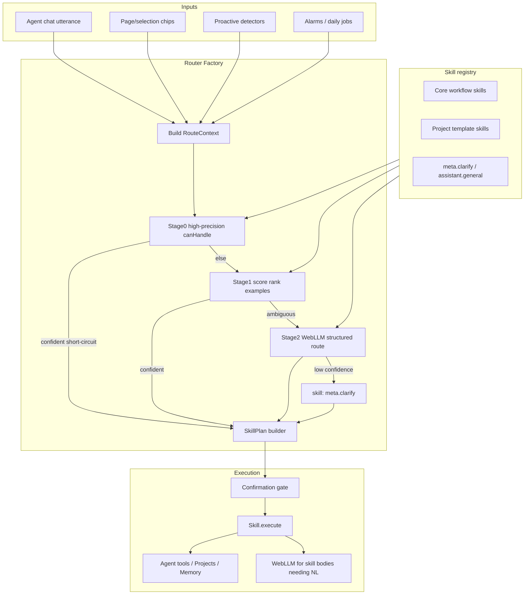

# ADR 0001 — Skills + Router Factory

| Field | Value |
|-------|-------|
| **Status** | Accepted for Phil v1 (Wave 0 freeze) |
| **Date** | 2026-08-07 |
| **Deciders** | Agent A0 (research) → implementers B1/C1/C3 must follow or amend this ADR with rationale |
| **Owns** | Wave 0 A0 (`docs/adr/**` only) |
| **Implements** | Wave 1 B1 (`src/agent/skills/**`, `src/agent/router/**`, `useAgent.ts` routing entry) |
| **Related** | [`docs/phil-go-live-plan.md`](../phil-go-live-plan.md) §17 (RTE-*/SKL-*), Persistent Projects §16, locked decisions (Google search, Calendar onboarding, device TZ) |
| **Supersedes** | Ad-hoc growth of `assistantIntent` / `goalIntent` / `useAgent` fast-paths as the *routing* source of truth (those helpers may remain as skill *implementations*) |

---

## 1. Problem statement

Phil must feel like a private on-device chief of staff. Every user turn (and many non-chat signals) needs to be **understood, categorized, and routed** to the right capability—reminders, goals, research, email, page actions, daily planning, focus coaching, memory, and especially **Persistent Project templates** (Career, Job Hunt, Research, Life Planner, Exec Day, Goal-aware browse).

Today’s request handling already has a thin skills layer (`src/agent/skills/`) that scores regex-backed intents and optionally builds a single tool call. That is a useful start, but:

1. **Routing is still brittle.** Scoring logic and phrase matchers live in `assistantIntent.ts`, `goalIntent.ts`, and `registry.ts`. Adding “Staff Engineer in 12 months” or “Move to Spain” as first-class flows would grow another maze of `if (mentions …)` branches—exactly what §17 forbids as long-term architecture.
2. **Context is underspecified.** `RouteContext` today is `{ goal, emailIntent? }`. It ignores active Persistent Project, current page/selection, Calendar connect state, device timezone, and Google-default research policy—all locked product decisions that must influence routing.
3. **No multi-skill plans.** Compare/decide workflows (WF-01), project setup + reminders, or “research then save” need ordered plans, not a single winner skill.
4. **No confirmation metadata.** Email send and clear-data must be skill-declared policies (SKL-02), not one-off UI branches.
5. **Extensibility is not proven.** RTE-07 requires registering a skill via factory without editing router core. The current static `AGENT_SKILLS` array can evolve into a registry API, but the contract is not frozen.

**Goal:** a **generic** pipeline:

```text
utterance + RouteContext → understand/categorize → Router Factory → SkillPlan → execute
```

New workflows (including project templates) are **registered skills**, not new hardcoded branches in `useAgent.ts`.

---

## 2. Anti-goals (what not to build in v1)

| Anti-goal | Why |
|-----------|-----|
| **Cloud routing / cloud classifiers** | Phil is local-first; no cloud inference for go-live. |
| **Full embedding / vector Milestone 4 as the router** | Explicitly out of plan scope; MiniSearch memory is separate from routing. |
| **Router = giant regex switch forever** | Fast regex short-circuits are allowed *inside* skills or as Stage-0 gates, not as the sole extensibility mechanism. |
| **One LLM turn that loads every tool schema every time** | On-device WebLLM context and latency cannot afford full agent loops for “remind me Tuesday 3 PM” (RTE-09). |
| **Separate routers per feature pod** | One Router Factory; template pods only call `registerSkill`. |
| **Competing Skill/Project type definitions** | A1 stubs + this ADR freeze; amend ADR before forking. |
| **Timezone picker or user-overridable scheduling TZ** | Device/browser default TZ only (`Intl`). |
| **DuckDuckGo-as-default research** | Google is the default SERP; fallbacks only on failure. |
| **Silent misroutes that create durable artifacts** | Ambiguity → clarify skill (RTE-03); wrong skill → recoverable correction (RTE-08). |
| **Shipping “coming soon” skill stubs in UI** | Skills may be registered behind flags for tests, but user-visible paths must work or not appear. |

---

## 3. Survey of routing approaches (on-device WebLLM / MV3)

Phil runs as a **Chrome MV3 extension** with **WebLLM on WebGPU**, limited context windows, no reliable long-running native threads in the service worker for heavy ML, and strict UX latency budgets. Approaches below are evaluated for **accuracy, latency, memory, extensibility, and fit with MV3**.

### 3.1 LLM structured-output router (same WebLLM model)

**Idea:** First model call returns JSON `{ skills: [...], args, confidence, clarify? }` from skill descriptions + few-shot examples.

| Pros | Cons (MV3 / WebLLM) |
|------|----------------------|
| Extensible: new skill = new description/examples in prompt | Extra full generation before work; hurts RTE-09 simple paths |
| Handles paraphrase / multi-intent better than regex | Small local models often emit malformed JSON / invent skill ids |
| Aligns with OpenAI/Anthropic tool-routing mental model | Prompt grows with every skill (context pressure) |
| | Cold-start / restore latency already high; double-call is expensive |

**Verdict:** Use as **Stage-2** for medium/low confidence only—not for every turn.

### 3.2 Dedicated small classifier (distilled intent model)

**Idea:** Tiny on-device classifier maps utterance → category/skill id.

| Pros | Cons |
|------|------|
| Fast, fixed latency | Extra model asset + download; conflicts with “one recommended model” onboarding |
| Decouples routing from chat quality | Training/eval pipeline not in repo; hard to keep in sync with skills |
| | Still needs arg extraction (dates, titles) via rules or second LLM |

**Verdict:** **Defer post-v1.** Not worth a second model for go-live.

### 3.3 Embeddings / kNN over skill examples

**Idea:** Embed utterance + skill example utterances; nearest neighbors vote.

| Pros | Cons |
|------|------|
| Good paraphrase recall; few-shot per skill | Plan out-of-scope for full vector Milestone 4 |
| Extensible via examples only | Embedding model download + IDB index complexity |
| | Weak at compositional multi-skill plans without a second stage |

**Verdict:** **Defer.** Optionally revisit if MiniSearch-style lexical matching over examples proves insufficient.

### 3.4 Pure tool-calling agent (no explicit router)

**Idea:** Dump all tools into the system prompt; model picks tools (OpenAI functions / Anthropic tools style).

| Pros | Cons |
|------|------|
| Simple conceptually; industry-default for cloud agents | Local models miss tools, narrate instead of calling, or loop |
| | Phil already compensates with nudges/`rewriteToolCallForIntent`—evidence the pure approach fails |
| | Does not encode confirmation policy or short-circuit plans |

**Verdict:** Keep as **fallback skill** (`assistant.general`) after routing, not as the router.

### 3.5 LangGraph / LangChain routers, Semantic Kernel plugins, AutoGen skills

**Idea:** Graph nodes / plugin catalogs / agent teams with explicit handoffs.

| Pros | Cons |
|------|------|
| Clear skill boundaries; multi-step plans | Full frameworks are Node/cloud-oriented; bundle size + MV3 CSP pain |
| Rich community patterns for clarify/handoff | Overkill vs a thin in-repo factory |
| SK “plugins” ≈ our skills | We need the *pattern*, not the dependency |

**Verdict:** **Adopt patterns** (plugin registry, plan → execute, clarify node)—**do not** vendor LangGraph/SK into the extension for v1.

### 3.6 Cursor / Copilot “skills” & browser-agent planners

**Idea:** Markdown/YAML skill packs with descriptions + procedures; planner selects packs.

| Pros | Cons |
|------|------|
| Description + examples as first-class metadata | Often assume cloud planning |
| Strong extensibility story (RTE-07) | Browser planners that drive tabs are adjacent to tools, not routing |

**Verdict:** Skill metadata shape (id, description, examples, permissions) should feel like these packs; execution stays Phil tools + projects.

### 3.7 Cascaded cheap-rules → LLM route → full agent (recommended family)

**Idea:**

1. **Stage 0 — Deterministic gates:** high-precision matchers / `canHandle` / `routeScore` for reminder, page.summarize-with-active-tab, open URL, etc.
2. **Stage 1 — Lexical / example overlap:** lightweight scoring over skill examples + category priors from context (active project, page present).
3. **Stage 2 — Structured LLM route:** only if top score below threshold or multi-skill ambiguity; constrained JSON schema; skill id enum.
4. **Stage 3 — Fallback agent:** `assistant.general` with a **trimmed** tool subset.

| Pros | Cons |
|------|------|
| Hits RTE-09 (simple reminder never waits on Stage 2) | Two code paths to keep consistent (rules + LLM) |
| Extensible: new skills register scores/examples without editing core | Must carefully tune thresholds to avoid rule dominance forever |
| Clarification as a first-class skill when confidence low | Stage 2 still needs robust JSON parse/repair (already in Phil) |
| Fits MV3: most turns pay only CPU regex + ranking | |

**Verdict:** **Phil v1 architecture.** Matches industry “router cascades” while respecting on-device constraints.

### 3.8 Comparison snapshot

| Approach | Latency | Extensibility | On-device fit | v1 role |
|----------|---------|---------------|--------------|---------|
| Structured LLM router always | Poor | High | Med | Stage 2 only |
| Small classifier | Good | Med | Poor (2nd model) | Out |
| Embeddings kNN | Med | High | Poor (M4) | Out |
| Pure tool agent | Poor | Med | Poor alone | Fallback skill |
| LangGraph/SK | Med | High | Poor (deps) | Patterns only |
| Cascade rules→LLM→agent | Best for common paths | High | **Best** | **Adopt** |

---

## 4. Recommended Phil v1 architecture

### 4.1 Principles

1. **Registry is the source of truth for routing**—not `useAgent` branches.
2. **Skills own domain logic**; helpers in `assistantIntent` / `goalIntent` migrate *into* skill modules as private implementation.
3. **Plans are first-class** (`SkillPlan`): zero or more ordered steps; empty/clarify is valid.
4. **Context-aware by default:** page, selection, active project, calendar capability, device TZ, search engine policy feed `RouteContext`.
5. **Confirmation is skill metadata**, enforced by the executor.
6. **Test hooks:** route debug (`route.skills`, confidence, stage) for RTE-* without user-visible noise.
7. **Proactive / browse events** synthesize synthetic utterances or dedicated `RouteTrigger`s into the same factory (do not invent a second router).

### 4.2 Component diagram



### 4.3 Data flow (chat turn)

1. `useAgent` (or B1-owned routing entry) builds `RouteContext` from utterance + side-panel state + storage.
2. `router.route(utterance, context)` returns `SkillPlan` + debug.
3. Executor runs steps in order:
   - If step requires confirmation → preview UI → wait.
   - Else `skill.execute(args, context, tools)`.
4. Skill may call tools, create/update projects, or request a bounded LLM completion with **skill-local** prompts (not the full tool zoo).
5. User-visible reply is composed by the skill or a thin presenter—EA voice, not raw tool JSON.

### 4.4 Failure modes

| Failure | Behavior |
|---------|----------|
| No skill above threshold | `meta.clarify` or `assistant.general` (SKL-03)—never dead-end |
| Stage-2 JSON invalid | Repair once; else fall back to top Stage-1 candidate or clarify |
| Skill throws / tool error | ERR-style recoverable message; plan aborts remaining side-effecting steps |
| User correction (“No, I meant a reminder”) | Re-route with `correctionHint` / prior plan in context (RTE-08); explain conflicting artifacts |
| Calendar disconnected on plan-day | Planning skill proceeds without events; notes enable path (WF-03)—does not invent events |
| Google SERP parse fail | Research skill uses ERR-03 fallback (open tab / helpful copy); engine remains Google-primary |
| Permission missing (Gmail/history) | Skill returns enable guidance (PRIV/BRW patterns), does not fake data |

### 4.5 Efficiency (RTE-09)

Documented short-circuit:

- Reminder / simple goal create / page summarize with chip / open https URL → **Stage 0 only**, `plan.flags.shortCircuit = true`, **no** Stage-2 LLM route call, **no** full tool-schema agent loop before the skill’s own tool call.
- Harness asserts: `debug.stage === 'stage0' | 'stage1'` and `debug.llmRouteCalls === 0` for golden reminder utterances.

### 4.6 Code homes (freeze)

| Path | Role |
|------|------|
| `src/agent/skills/types.ts` | Skill contract (A1 aligns to this ADR) |
| `src/agent/skills/registry.ts` → evolve to factory | `registerSkill`, `listSkills`, get-by-id |
| `src/agent/skills/*.ts` / `workflows/**` / `projects/**` | Skill modules |
| `src/agent/router/` | `createRouterFactory`, stages, `route()`, debug |
| `src/hooks/useAgent.ts` | **Single** chat routing entry (B1); no parallel intent maze |
| Existing `assistantIntent.ts` / `goalIntent.ts` | Temporary; migrate behind skills then thin re-exports |

---

## 5. Categorization taxonomy (skills, not 1:1 categories)

Categories are **routing priors**, not necessarily one skill each. Multiple skills may share a category; one skill may serve multiple categories via examples.

| Category | Example skills (ids) | Notes |
|----------|----------------------|-------|
| **reminder** | `reminder.create`, `reminder.update`, `reminder.conflict_check` | Device TZ for parse; SET-08 |
| **goal** | `goal.create`, `goal.progress` | Prefer promoting long-horizon → project skills |
| **project** | `project.create`, `project.status`, `project.set_active` | Persistent Projects core |
| **project.career** | `project.career_accelerator` | PRJ-CA-* |
| **project.job_hunt** | `project.job_hunt` | PRJ-JH-*; constraints in project metrics |
| **project.research** | `project.research_manager` | PRJ-RP-*; knowledge capture |
| **project.life** | `project.life_planner` | PRJ-LP-* |
| **project.exec_day** | `project.exec_day` | PRJ-EA-*; overlaps planning |
| **project.goal_aware** | `project.goal_aware_browse` | PRJ-GA-*; often non-chat trigger |
| **research** | `research.web`, `research.compare_decide` | **Google default** SERP |
| **email** | `email.reply_draft`, `email.list`, `email.send` | send = confirm required |
| **page** | `page.summarize`, `page.explain`, `page.ask`, `page.counterargue` | Prefer when `context.page` present |
| **selection** | `selection.explain`, `selection.summarize`, `selection.rewrite`, `selection.translate` | Chip/context-menu |
| **planning** | `planning.workday`, `briefing.morning`, `briefing.evening` | Calendar read if connected |
| **focus** | `focus.coach`, `focus.summary`, `focus.session_start` | WF-07/19/20 |
| **memory** | `memory.remember`, `memory.forget`, `memory.recall` | Honor memory-off |
| **browser_memory** | `browser_memory.find` | History permission |
| **settings_privacy** | `privacy.explain`, `data.clear` | clear = confirm |
| **meta** | `meta.clarify`, `assistant.general` | RTE-03, SKL-03 |
| **chitchat** | folded into `assistant.general` | Low priority vs durable skills |

**Persistent Projects in taxonomy:** Long-horizon utterances (“within 12 months”, “over six months”, “I’m moving…”, “I’m buying…”, salary+role constraints) should prefer **project.\*** skills over bare `goal.create`. Short “set a goal to finish the proposal today” may stay `goal.create`. Router uses horizon cues + template keywords + `context.activeProject`.

**Default search engine:** `research.*` skills read `context.search.defaultEngine = 'google'` (locked). Scoring must not prefer a DDG-specific skill; legacy `web_lookup` migrates to `research.web` with Google primary.

---

## 6. Context-aware routing

`RouteContext` must expose features the cascade uses as score boosts / gates—not only the raw string.

### 6.1 Locked product signals

| Signal | Routing implication |
|--------|---------------------|
| **Device timezone** | Always `context.time.timeZone = Intl.DateTimeFormat().resolvedOptions().timeZone` (or harness). Reminder/planning skills parse “next Tuesday 3 PM”, quiet hours, recurrence in **device TZ**. No Settings TZ. User memory text about TZ does **not** override scheduling. |
| **Calendar** | `context.calendar = { connected: boolean }`. Set in onboarding (ONB-08, skippable). `planning.workday` / Life Planner / daily briefing **read today’s events when connected**; when skipped, plan without events and may nudge Privacy enable—never invent events. |
| **Google default search** | `context.search = { defaultEngine: 'google', fallbackEngines?: string[] }`. Research skills must query Google first; fallbacks only on failure (ERR-03). |

### 6.2 Session / surface signals

| Signal | Use |
|--------|-----|
| `activeProject` | Boost matching `project.*` / job-hunt daily search for elliptical asks (“Any new ones today?” → RTE-06) |
| `page` (url, title, extract available) | “Summarize this” → `page.summarize` not `research.web` (RTE-05) |
| `selection` | Selection actions / ELI5 |
| `openTabs` summary | Compare-tabs proactive → research.compare or proactive suggestion skill |
| `gmailAvailable` / permissions | Gate email skills vs enable-copy |
| `historyAvailable` | Gate browser_memory |
| `memoryEnabled` | Gate remember writes |
| `timeOfDay` / local clock | Briefing vs evening recap priors; quiet hours for notifications (executor/settings) |
| `priorPlan` / `correctionHint` | Misroute recovery |
| `trigger` | `'chat' \| 'chip' \| 'context_menu' \| 'proactive' \| 'alarm'` — chips may force Stage-0 skill |

---

## 7. Skill contract (TypeScript-shaped)

Implementers (A1/B1) should treat the following as the freeze target. Names may gain namespaces (`reminder.create`) vs today’s flat `reminder`; migration maps old ids → new.

```typescript
/** Confirmation policy — executor must honor before side effects. */
export type ConfirmationLevel =
  | 'none' // reminders, research fetch, page read
  | 'notify' // soft: show what will happen, no blocking Allow
  | 'confirm' // email send, destructive clear — preview then explicit approve
  | 'never_auto'; // alias of confirm for send/clear; never actDontAsk

export type SkillPermission =
  | 'tabs'
  | 'scripting'
  | 'notifications'
  | 'identity_gmail'
  | 'calendar'
  | 'history'
  | 'storage_memory'
  | 'storage_projects';

export type SkillCategory =
  | 'reminder'
  | 'goal'
  | 'project'
  | 'research'
  | 'email'
  | 'page'
  | 'selection'
  | 'planning'
  | 'focus'
  | 'memory'
  | 'browser_memory'
  | 'settings_privacy'
  | 'meta'
  | 'chitchat';

/** JSON-schema-like input description for Stage-2 and validators. */
export type SkillInputSchema = {
  type: 'object';
  properties: Record<string, unknown>;
  required?: string[];
  additionalProperties?: boolean;
};

export type RouteContext = {
  utterance: string;
  /** Normalized copy of utterance for matchers. */
  utteranceNorm?: string;
  trigger: 'chat' | 'chip' | 'context_menu' | 'proactive' | 'alarm';
  time: {
    nowMs: number;
    /** Device/browser TZ — sole scheduling authority. */
    timeZone: string;
    localHour?: number;
  };
  calendar: {
    connected: boolean;
    /** When connected, optional prefetched today summary for planning skills. */
    todayEventCount?: number;
  };
  search: {
    /** Locked default for v1. */
    defaultEngine: 'google';
    fallbackEngines?: Array<'duckduckgo' | 'bing' | string>;
  };
  page?: {
    url: string;
    title?: string;
    hasExtract: boolean;
  };
  selection?: {
    text: string;
    editable?: boolean;
  };
  activeProject?: {
    id: string;
    title: string;
    template:
      | 'career'
      | 'job_hunt'
      | 'research'
      | 'exec_day'
      | 'life_move'
      | 'custom';
  };
  permissions: Partial<Record<SkillPermission, boolean>>;
  memoryEnabled: boolean;
  /** Prior conversation crumbs (short). */
  recentTurns?: Array<{ role: 'user' | 'assistant'; text: string }>;
  priorPlan?: SkillPlan;
  correctionHint?: string;
  /** Test/harness only. */
  testMode?: boolean;
};

export type SkillScore = {
  /** 0–1; router ranks by score then priority. */
  score: number;
  reasons?: string[];
};

export type SkillExecutionTools = {
  executeTool: (
    name: string,
    args: Record<string, unknown>,
    opts?: { confirmed?: boolean },
  ) => Promise<unknown>;
  llm?: {
    complete: (prompt: string, opts?: { maxTokens?: number }) => Promise<string>;
  };
  projects?: {
    create: (input: unknown) => Promise<{ id: string }>;
    get: (id: string) => Promise<unknown>;
    update: (id: string, patch: unknown) => Promise<void>;
  };
};

export type SkillResult = {
  ok: boolean;
  /** User-facing markdown/plain reply fragment. */
  message?: string;
  data?: unknown;
  error?: string;
  /** Artifacts created for PRJ-02 linking. */
  linked?: { projectId?: string; goalIds?: string[]; reminderIds?: string[] };
};

/**
 * Skill — named capability registered in the Router Factory.
 * Fast-path regex may live inside score/canHandle/execute, not in useAgent.
 */
export type Skill = {
  /** Stable id, dotted namespace preferred: "reminder.create". */
  id: string;
  description: string;
  category: SkillCategory;
  /** Few-shot utterances for Stage-1 overlap and Stage-2 prompt. */
  examples: string[];
  inputSchema: SkillInputSchema;
  permissions?: SkillPermission[];
  confirmationLevel: ConfirmationLevel;
  /** Optional static priority tie-break (higher wins). Default 0. */
  priority?: number;

  /**
   * Cheap gate. If false, skill is skipped in Stage 0/1.
   * Default: () => true.
   */
  canHandle?: (ctx: RouteContext) => boolean;

  /**
   * Score 0–1 for this utterance+context. Prefer precision.
   * May wrap legacy assistantIntent matchers during migration.
   */
  score: (ctx: RouteContext) => SkillScore | number;

  /**
   * Optional arg extraction for short-circuit plans (Stage 0/1).
   * Stage 2 may supply args from JSON instead.
   */
  extractArgs?: (ctx: RouteContext) => Record<string, unknown> | null;

  /** Execute the skill. Side effects only through tools/projects APIs. */
  execute: (
    args: Record<string, unknown>,
    ctx: RouteContext,
    tools: SkillExecutionTools,
  ) => Promise<SkillResult>;
};

export type SkillPlanStep = {
  skillId: string;
  args: Record<string, unknown>;
  confirmationLevel: ConfirmationLevel;
};

export type SkillPlan = {
  steps: SkillPlanStep[];
  /** True when Stage 0/1 short-circuited without LLM route. */
  shortCircuit: boolean;
  /** If set, executor should ask the user before other side effects. */
  clarifyQuestion?: string;
  confidence: 'high' | 'medium' | 'low';
};

export type RouteDebug = {
  stage: 'stage0' | 'stage1' | 'stage2' | 'clarify' | 'fallback';
  ranked: Array<{ id: string; score: number }>;
  llmRouteCalls: number;
  skills: string[]; // plan skill ids — RTE harness
};

export type RouteResult = {
  plan: SkillPlan;
  debug: RouteDebug;
};
```

### 7.1 Confirmation mapping (SKL-02)

| Skill family | Level |
|--------------|-------|
| `reminder.*`, `goal.create`, `research.web` (fetch), `page.*`, `briefing.*` | `none` (or `notify`) |
| `email.reply_draft` (compose preview) | `notify` / preview |
| `email.send` | `confirm` / `never_auto` |
| `data.clear` / clear chats/memories | `confirm` |
| Project create | `none` or soft confirm if destructive overwrite |

---

## 8. Router Factory API

```typescript
export type RouterFactory = {
  registerSkill: (skill: Skill) => void;
  unregisterSkill?: (id: string) => void; // tests
  listSkills: () => readonly Skill[];
  getSkill: (id: string) => Skill | undefined;

  /**
   * Understand → categorize → route → SkillPlan.
   * Does not execute; caller/executor runs the plan.
   */
  route: (utterance: string, context: Omit<RouteContext, 'utterance'> | RouteContext) => Promise<RouteResult>;

  /** Sync variant for Stage-0-only paths / unit tests when LLM unavailable. */
  routeSync?: (utterance: string, context: RouteContext) => RouteResult;
};

export type CreateRouterFactoryOptions = {
  /** Stage-0/1 accept threshold (suggested 0.75 for short-circuit). */
  shortCircuitThreshold?: number;
  /** Below this after Stage 1 → clarify or Stage 2 (suggested 0.55). */
  minAcceptThreshold?: number;
  /** Inject LLM for Stage 2; omit → skip to clarify/fallback. */
  llmRouter?: {
    route: (input: {
      utterance: string;
      context: RouteContext;
      catalog: Array<Pick<Skill, 'id' | 'description' | 'examples' | 'inputSchema'>>;
    }) => Promise<{ skillIds: string[]; argsBySkill?: Record<string, Record<string, unknown>>; clarify?: string; confidence: number }>;
  };
  /** Default search policy baked into context if caller omits. */
  defaultSearchEngine?: 'google';
};

export function createRouterFactory(opts?: CreateRouterFactoryOptions): RouterFactory;
```

### 8.1 `route()` algorithm (normative)

1. Normalize context: ensure `search.defaultEngine = 'google'`, `time.timeZone` from device, merge `utterance`.
2. Candidate set = skills where `canHandle(ctx) !== false` and permissions satisfied **or** skill is designed to explain missing permission.
3. **Stage 0:** If exactly one skill with `score >= shortCircuitThreshold` and `extractArgs` succeeds (or args empty OK), return single-step plan with `shortCircuit: true`, `llmRouteCalls: 0`.
4. **Stage 1:** Rank by score (+ `priority` + context boosts: page→page skills, activeProject.template→matching project skill). If top ≥ threshold and margin over #2 ≥ δ (e.g. 0.15), build plan (allow 2-step if skill declares companion via Stage-2 only—or fixed pairs like research→memory.save when utterance contains “save”).
5. **Stage 2:** If configured and needed, LLM returns skill ids ∈ catalog enum. Validate ids. On failure → Stage 1 top or clarify.
6. **Clarify:** If still ambiguous / anaphora without referent → `meta.clarify` plan with question (RTE-03).
7. **Fallback:** `assistant.general` with trimmed tools (SKL-03).

Multi-skill (RTE-04): Stage 2 may return ordered `skillIds`; Stage 1 may use utterance cues (“compare … and recommend”, “save this”) to append `memory.save` / `research.compare_decide`.

### 8.2 Registration (RTE-07 / SKL-01)

At startup (and in tests):

```typescript
const router = createRouterFactory({ defaultSearchEngine: 'google' });
registerCoreSkills(router);       // reminder, goal, research, email, page, …
registerProjectTemplateSkills(router); // career, job_hunt, … (C1)
// harness:
router.registerSkill(testOnlySkill);
```

Core enumerable skills for SKL-01 (minimum):  
`reminder.create`, `goal.create` / `project.create`, `research.web` (+ compare), `email.reply_draft`, `page.summarize`, `focus.coach` or `focus.summary`, `memory.remember`, `planning.workday` or `briefing.morning`, plus project templates Career, Job Hunt, Research, Life Planner (and Exec Day / Goal-aware as registered families).

---

## 9. Migration plan (current → Factory)

### 9.1 Current state (as of Wave 0 base)

| Piece | Role today |
|-------|------------|
| `src/agent/skills/types.ts` | Flat `SkillId`, `AgentSkill.score`, optional `buildToolCall` |
| `registry.ts` | Static `AGENT_SKILLS`; wraps `assistantIntent` matchers |
| `router.ts` | `routeGoal` — argmax score ≥ 0.55 → single `AgentRoute` |
| `assistantIntent.ts` | Regex intent + reminder/goal parsers |
| `goalIntent.ts` | Email/open-link/summarize intents + nudges/rewrites |
| `useAgent.ts` | `resolveRoute` → hints + fast tool execution; still rich email special cases |

### 9.2 Phased migration (B1 owns; no big-bang rewrite required)

**Phase A — Adapter (unblocks RTE wiring)**  
- Introduce `createRouterFactory` + new `Skill` types alongside legacy `AgentSkill`.  
- Wrap each legacy skill as `Skill` with `score` delegating to existing matchers; `execute` calling former `buildToolCall` + tool runner.  
- `route()` returns `SkillPlan` with one step; `useAgent` maps plan → today’s loop.  
- Keep `routeGoal` as deprecated wrapper calling factory.

**Phase B — Context enrichment**  
- Expand `RouteContext` (page, project, calendar, TZ, search).  
- Page chip paths force `page.summarize` Stage-0.  
- Reminder parse uses device TZ (may still use relative `inMinutes` until C3 absolute datetimes).

**Phase C — Split & rename**  
- Map ids: `reminder` → `reminder.create`, `web_lookup` → `research.web`, `gmail` → `email.*`, `chat` → `assistant.general`, `briefing` → `briefing.morning`, etc.  
- Move `isReminderGoal` / parsers into `skills/workflows/reminderCreate.ts` (private).  
- Peel email branches from `useAgent` into `email.reply_draft` skill (still may call `goalIntent` helpers internally).

**Phase D — Plans & Stage 2**  
- Multi-step plans for compare/decide + save.  
- Optional Stage-2 structured route when confidence medium.  
- `meta.clarify` for RTE-03.

**Phase E — Projects**  
- C1 registers template skills only via `registerSkill`.  
- Long-horizon scoring prefers project skills over `goal.create`.

**Phase F — Delete dead routing**  
- Remove duplicate switches from `useAgent` once skills cover paths; leave tools/parser infrastructure.

### 9.3 Compatibility table

| Legacy | v1 skill | Notes |
|--------|----------|-------|
| `reminder` | `reminder.create` | TZ-aware when absolute times land |
| `goal` | `goal.create` | Horizon → project.* |
| `focus` | `focus.summary` | Coaching → `focus.coach` |
| `briefing` | `briefing.morning` | Evening separate |
| `gmail` | `email.list` / `email.reply_draft` / `email.send` | confirm on send |
| `open_link` | `tabs.open_url` or under browse | Stage 0 |
| `browse_page` | `research.browse` / tabs+page_read | |
| `live_weather` | `research.web` with weather specialty **or** keep sub-skill | Google/live fetch policy via research tool |
| `web_lookup` | `research.web` | **Google default** |
| `chat` | `assistant.general` | Fallback |

---

## 10. Safety, permissions, confirmations

- Skills declare `permissions` + `confirmationLevel`.  
- Executor checks permission state from Privacy/onboarding before side effects.  
- `actDontAsk` legacy flag maps to `confirmationLevel: 'none'` for read-only browse/research only—**never** for send/clear.  
- Proactive triggers must respect notification frequency / quiet hours (settings)—router may still *select* a skill; delivery is gated elsewhere.

---

## 11. Evaluation set (≥30 golden utterances)

Expected skills use **v1 ids**. Harness may assert `debug.skills` / plan step ids. Context columns list minimum features.

| # | Utterance | Context | Expected skill(s) | Notes |
|---|-----------|---------|-------------------|-------|
| 1 | Remind me to call my landlord next Tuesday at 3 PM. | device TZ | `reminder.create` | RTE-01, WF-04, Stage 0 |
| 2 | Remind me in 20 minutes to stretch | — | `reminder.create` | Legacy parity |
| 3 | Remind me every Friday to review my finances. | — | `reminder.create` | recurrence args |
| 4 | Remind me to go to the gym every weekday at 18:00. | — | `reminder.create` | WF-18 part 1 |
| 5 | Every Tuesday at 18:00 remind me to attend my language class. | prior gym reminder | `reminder.create` + conflict check | WF-18 |
| 6 | Remind me when I've spent more than an hour on YouTube today. | focus on | `reminder.create` or `focus.coach` | threshold rule |
| 7 | Set a goal to finish the proposal | — | `goal.create` | short horizon |
| 8 | I want to pass my AWS Solutions Architect exam by the end of October. | harness date | `goal.create` and/or `project.create` | WF-02 |
| 9 | I want to become a Staff Engineer within 12 months. | — | `project.career_accelerator` | RTE-02, PRJ-CA |
| 10 | I want a remote backend job paying at least €120k. | — | `project.job_hunt` | PRJ-JH |
| 11 | I'm researching whether to buy an electric car this year. | — | `project.research_manager` | PRJ-RP |
| 12 | I'm moving to Spain in six months. | — | `project.life_planner` | PRJ-LP |
| 13 | I'm buying my first home. | — | `project.create` / life or custom home template | PRJ-GA-01 |
| 14 | Help me build a startup over the next six months. | — | `project.create` | WF-17 |
| 15 | I'm planning a trip to Japan next April. | — | `project.create` or travel goal skill | WF-10 |
| 16 | I'm preparing for a Staff Engineer interview next week. | — | `project.career_accelerator` or goal+reminders | WF-14 |
| 17 | I'm looking for a mechanical keyboard under $150 with hot-swappable switches. Compare the best options and recommend one. | — | `research.compare_decide` | RTE-04, WF-01; Google |
| 18 | Find the three best project management tools for startups. | — | `research.web` / compare | WF-06 |
| 19 | Which one has the best API? | prior PM tools thread | `research.web` (contextual) | follow-up |
| 20 | Find the cheapest direct flight from Warsaw to Tokyo in April. | — | `research.compare_decide` | WF-16; Google |
| 21 | Find arguments against the claims made on this page. | page extract | `page.counterargue` (+ research) | WF-13 |
| 22 | Summarize this page. | page extract | `page.summarize` | RTE-05, WF-11 |
| 23 | Summarize this | page extract | `page.summarize` | not research.web |
| 24 | What is the rollback step on this page? | page extract | `page.ask` | PAGE-03 |
| 25 | Reply to John's last email saying I can meet Thursday afternoon. | gmail available | `email.reply_draft` | WF-05; confirm before send |
| 26 | List my last 5 emails | gmail | `email.list` | |
| 27 | Plan my workday. | goals+reminders; calendar connected | `planning.workday` | includes events |
| 28 | Plan my workday. | calendar skipped | `planning.workday` | no invented events |
| 29 | What's up today? | — | `briefing.morning` | |
| 30 | How am I doing on my goals this week? | goals seeded | `goal.progress` | WF-08 |
| 31 | Where am I? | active home-buying project | `project.status` | PRJ-GA-03 |
| 32 | What projects am I working on? | 2 projects | `project.list` / set_active | PRJ-04 |
| 33 | Any new ones today? | active job_hunt project | `project.job_hunt` (daily search) | RTE-06 |
| 34 | What's your recommendation? | active EV research project | `project.research_manager` | PRJ-RP-03 |
| 35 | Help me stay focused while I work on my thesis today. | — | `focus.coach` | WF-07 |
| 36 | How productive was I today? | focus data | `focus.summary` | WF-19 |
| 37 | Help me stay on track today. | active goal | `focus.coach` / `project.exec_day` | WF-20 |
| 38 | Help me stay productive today. | — | `project.exec_day` | PRJ-EA |
| 39 | Remember that I prefer morning briefings at 7. | memory on | `memory.remember` | MEM-01 |
| 40 | What did I ask you to remember about briefings? | memory seeded | `memory.recall` | |
| 41 | Find that Kubernetes article I read last week. | history granted | `browser_memory.find` | BRW-01 |
| 42 | Help me with that thing we discussed | insufficient context | `meta.clarify` | RTE-03 |
| 43 | Do you think I should take the job? | — | `assistant.general` | chitchat/opinion |
| 44 | What is the weather today? | — | `research.web` (weather) | Google/live path |
| 45 | Open https://example.com in a new tab | — | open URL skill | Stage 0 |
| 46 | I want to learn Kubernetes. | — | `goal.create` + playbook / project | EA-01 |
| 47 | Save this comparison | after research plan | `memory.save` (+ project knowledge if active) | WF-01 follow-up |
| 48 | No, I meant set a reminder | after wrong skill | re-route `reminder.create` | RTE-08 |
| 49 | Clear all my memories | — | `data.clear` | confirm required |
| 50 | Research noise-cancelling headphones under $100 | — | `research.web` | Google default |

**Coverage check:** reminder, goal, research, email, page, project (career/job-hunt/research/life/exec/home), clarify, focus, memory, browser_memory, planning/calendar variants, misroute recovery, Google research — **≥30** rows (50 listed for implementer cushion).

### 11.1 Eval harness expectations

- Unit: `route()` goldens without WebLLM for Stage-0/1 rows.  
- E2e RTE-*: sidebar + `testMode` debug.  
- Track **misroute rate** vs **llmRouteCalls** (efficiency).  
- Do not assert wall-clock alone for RTE-09.

---

## 12. Decisions locked by this ADR (implementers must not silently reverse)

1. **Cascade** Stage0 → Stage1 → Stage2 → clarify/fallback — not pure-LLM-always, not regex-only forever.  
2. **Google** is default research engine in context and research skills.  
3. **Device TZ** is sole scheduling authority; exposed on `RouteContext.time.timeZone`.  
4. **Calendar** connectivity is a routing/planning input from onboarding; skippable.  
5. **Persistent Project templates register as skills**; long-horizon asks prefer them over bare goals.  
6. **ConfirmationLevel** on skills; email send / data clear require confirm.  
7. **One Router Factory**; extensibility via `registerSkill` (RTE-07).  
8. **Short-circuit** simple reminders without Stage-2 LLM (RTE-09).  
9. **Legacy intent helpers** may implement skills but must not remain the routing SoT.  
10. Competing designs require an ADR amendment first.

---

## 13. Open questions

See also append-only entries in [`docs/agent-review-log.md`](../agent-review-log.md) (Agent A0).

1. **Stage-2 model:** Same chat WebLLM vs skipped entirely when Stage-1 margin is weak—ship Stage-2 in B1 or defer to Wave 2 if JSON reliability is poor on the recommended small model?  
2. **Skill id naming:** Strict dotted namespaces now vs keep flat legacy ids until Phase C? A1/B1 should pick one for the shared stubs freeze.  
3. **Multi-skill without Stage-2:** Allow declarative `companions` / `planTemplates` on skills, or only LLM-authored multi-steps in v1?  
4. **Weather:** Keep dedicated `live_weather` sub-skill vs fold into `research.web` with specialty arg?  
5. **Proactive → router:** Detectors call `route()` with synthetic utterances, or register `trigger: 'proactive'`-only skills with separate `matchDetector`?  
6. **`project.create` vs template skills:** Does a generic create skill dispatch by classifier to templates, or does the router select `project.career_accelerator` directly? (**Recommendation:** router selects template skill directly; generic create is fallback for `custom`.)  
7. **Absolute datetime parsing** for “next Tuesday 3 PM” in device TZ: owned by reminder skill (C3) vs shared chrono util from B1?  
8. **Score API sync vs async:** If Stage-1 ever needs MiniSearch over examples, should `score` become async now? (**Recommendation:** sync scores in v1; `route()` already async for Stage-2.)  
9. **Email special cases in `useAgent`:** How much of `rewriteToolCallForIntent` survives inside email skills vs deleted after Phase C?  
10. **Threshold constants:** Finalize `shortCircuitThreshold` / `minAcceptThreshold` / margin δ after golden eval run—values in §8.1 are starting points.

---

## 14. References (patterns surveyed)

- OpenAI function/tool calling & structured outputs — router-as-model baseline  
- Anthropic tool use — parallel tools, user confirmation patterns  
- LangGraph `ToolNode` / conditional edges — plan graphs without requiring the library  
- Semantic Kernel plugins — skill = description + parameters + invoke  
- AutoGen / multi-agent skill handoff — clarify agent analogue = `meta.clarify`  
- Cascaded intent systems (rules → ML → LLM) — common production voice/assistant pattern  
- Phil go-live plan §15–17 — WF/PRJ/RTE requirements and locked Google / Calendar / TZ decisions  
- In-repo precursor — `src/agent/skills/{types,registry,router}.ts` + `assistantIntent.ts` + `useAgent.ts`
)
