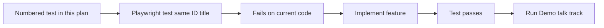
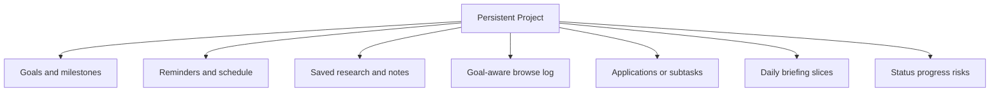
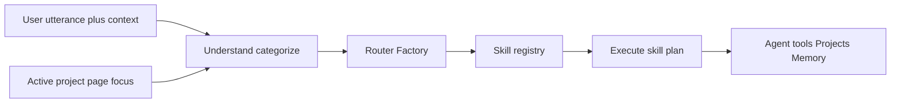
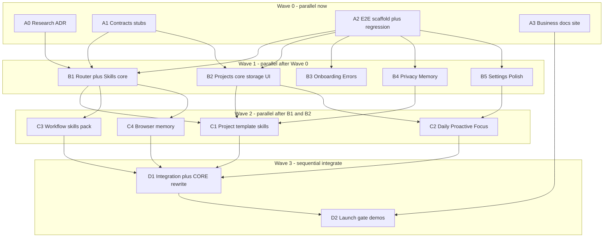
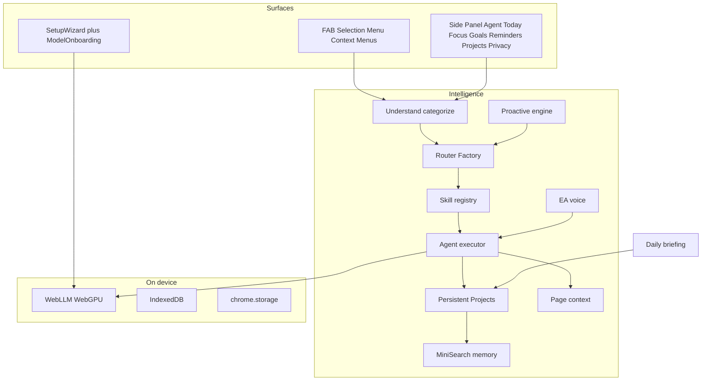

---
todos:
  - id: wave0-a0-research
    status: in_progress
    content: 'Wave0/A0: Research ADR skills-router (docs/adr only)—separate agent'
  - id: wave0-a1-contracts
    status: in_progress
    content: 'Wave0/A1: Shared Skill/Router/Project TypeScript contract stubs; seed docs/agent-review-log.md if missing'
  - id: wave0-a2-e2e-scaffold
    status: in_progress
    content: 'Wave0/A2: Encode all test IDs as Playwright; green PAGE/SEL/SET-01/WF-11/12'
  - id: wave0-a3-business
    status: in_progress
    content: 'Wave0/A3: Landing, legal, CWS assets, demo script (BIZ docs)'
  - id: wave1-b1-router
    content: 'Wave1/B1: Skills registry + Router Factory; RTE-*/SKL-* green'
    status: pending
  - id: wave1-b2-projects-core
    content: 'Wave1/B2: Persistent Projects core storage/UI/tools; PRJ-01…06'
    status: pending
  - id: wave1-b3-onboarding
    content: 'Wave1/B3: Onboarding + Calendar step (ONB-08) + error recovery; ONB-*/ERR-*'
    status: pending
  - id: wave1-b4-privacy-memory
    content: 'Wave1/B4: Privacy dashboard + memory; PRIV-*/MEM-* (includes Calendar status)'
    status: pending
  - id: wave1-b5-settings-polish
    content: 'Wave1/B5: SET-02…07 + SET-08 device-TZ scheduling + POL-*'
    status: pending
  - id: wave2-c1-project-skills
    content: 'Wave2/C1: Project template skills CA/JH/RP/LP/GA'
    status: pending
  - id: wave2-c2-daily-proactive
    content: 'Wave2/C2: DAY-*/PRO-*/PRJ-EA-* + coaching WFs'
    status: pending
  - id: wave2-c3-workflow-skills
    content: 'Wave2/C3: WF skills; Google-default research; calendar read for planning'
    status: pending
  - id: wave2-c4-browser-memory
    content: 'Wave2/C4: BRW-* browser memory skill'
    status: pending
  - id: wave3-d1-integration
    content: 'Wave3/D1: Merge wiring, CORE rewrite, full e2e green'
    status: pending
  - id: wave3-d2-launch-gate
    content: 'Wave3/D2: Demos + launch gate; triage docs/agent-review-log.md (no untriaged blockers)'
    status: pending
name: Phil Go-Live Plan
overview: Ship Phil with Persistent Projects and a Skills/Router Factory. Spec-first e2e in this plan. Split across parallel agent pods in waves (see Multi-agent parallelization)—Wave 0 research/contracts/e2e/business can start immediately.
isProject: false
---
# Phil Go-Live Plan (Spec-First)

## Product story (north star)

Phil must feel like:

**“A private AI chief of staff that lives in your browser, understands what you’re working on, helps you research faster, keeps you on track, and proactively assists throughout your day.”**

The structural unlock is **Persistent Projects**. Goals, reminders, email drafts, web research, productivity, and daily briefings are not scattered features — they attach to named long-running projects (e.g. “Staff Engineer Promotion”, “Move to Spain”, “Buy a House”). That persistent context is what generic chatbots cannot replicate and why users come back.

The efficiency unlock is a **Skills + Router Factory**: every user request is understood and routed to the right skill(s) through a scalable, generic pipeline—not a growing maze of hardcoded `if (mentions Kubernetes)` workflow paths. Project templates (Career, Job Hunt, Research, Life Planner, etc.) register as skills; the router decides when to invoke them.

There is **one** launch list. Nothing here is optional. Every item is **implemented, covered by the numbered e2e tests below, and demoable**.

**Non-negotiable:** No “coming soon,” disabled fake toggles, Milestone stubs that throw, or unfinished sample flows in the shipped build. **Do not** ship v1 with brittle one-off request path hardcoding as the long-term architecture—fast-paths may exist as skill implementations behind the router, not as the router itself.

**Out of scope:** cloud inference, mobile, non-Chromium stores, full embedding/vector Milestone 4, AI tab grouping, duplicate-tab product UI, weekly reports, achievements/streaks. (Browse-triggered smart reminders = proactive engine detectors scoped to projects.)

### Locked product decisions

| Decision | v1 rule |
|----------|---------|
| **Calendar** | First-class **onboarding step** (skippable like Gmail). When connected, WF-03 / Life Planner / daily planning read today’s events. When skipped, Phil plans without calendar and can prompt to enable later in Privacy. |
| **Default search engine** | **Google** is the default for web research / SERP (replace DuckDuckGo-as-default). Fallback tabs may still offer alternatives on failure, but primary query path is Google. |
| **Timezone** | Always use the **device/browser default** (`Intl` / system TZ). No timezone picker in Settings. Reminder “next Tuesday 3 PM”, quiet hours, and recurrence evaluate in device TZ. Users may still *remember* a preference as memory text; that does not override system TZ for scheduling. |

---

## How agents should use this plan



1. Pick a test ID (e.g. `ONB-03`).
2. Create `test('ONB-03: …', …)` whose title matches the plain-English name below.
3. Assert only what the **Then** / **Expect** lines say (user-visible).
4. Add any **Harness** listed (fixtures in [`e2e/fixtures/extension.ts`](e2e/fixtures/extension.ts)).
5. If the ID is marked **Already implemented**, treat as regression: encode the test and expect green; only fix product code if it fails. Do not rebuild the feature from scratch.
6. Otherwise implement product code until green. Do not weaken the Expect lines.
7. When a whole group is green, record/run that group’s **Demo talk track**.
8. **Always** append unclear requirements, open questions, missing/skipped/deferred implementation to [`docs/agent-review-log.md`](docs/agent-review-log.md) (see Multi-agent parallelization → Agent review log). Do not leave silent gaps.

**Separate research agent:** Todo `research-router-skills` / Wave0 A0 (§17) is intentionally assigned to a **different agent** from feature implementers. That agent only researches and writes the ADR/skill contract/evaluation set—it does not implement product features. Implementers consume the ADR before building RTE-*/SKL-* and before adding new WF/PRJ skills. **A0 must also log open research questions and unresolved ADR decisions into `docs/agent-review-log.md`.**

**Already implemented (regression e2e only — do not rebuild):**
- All **PAGE-*** (current page awareness)
- All **SEL-*** (highlight quick actions)
- **SET-01** (change and load AI model)
- **WF-11** (Summarize this page) and **WF-12** (Explain selection / ELI5) — same shipped page/selection paths

**Stubbing rule:** You may stub WebLLM / network at the model boundary for speed. Never stub the feature under test. Prefer existing `philPage` (no model) vs `readySidebar` / `agentPage` (model loaded) from the extension fixtures.

**Suggested Playwright files** (agents may split further):

| File | Test IDs |
|------|----------|
| `e2e/onboarding.spec.ts` | ONB-* |
| `e2e/errors.spec.ts` | ERR-* |
| `e2e/privacy.spec.ts` | PRIV-* |
| `e2e/memory.spec.ts` | MEM-* |
| `e2e/settings.spec.ts` | SET-* |
| `e2e/page-context.spec.ts` | PAGE-*, WF-11, WF-13 |
| `e2e/selection-actions.spec.ts` | SEL-*, WF-12 |
| `e2e/daily-review.spec.ts` | DAY-* |
| `e2e/browser-memory.spec.ts` | BRW-* |
| `e2e/personality.spec.ts` | EA-* |
| `e2e/proactive.spec.ts` | PRO-* |
| `e2e/polish.spec.ts` | POL-* |
| `e2e/business.spec.ts` | BIZ-* |
| `e2e/workflows-research.spec.ts` | WF-01, WF-06, WF-16 |
| `e2e/workflows-goals-planning.spec.ts` | WF-02, WF-03, WF-08, WF-14, WF-17 |
| `e2e/workflows-reminders.spec.ts` | WF-04, WF-09, WF-15, WF-18 |
| `e2e/workflows-email.spec.ts` | WF-05 |
| `e2e/workflows-focus-coaching.spec.ts` | WF-07, WF-19, WF-20 |
| `e2e/projects.spec.ts` | PRJ-01…06 (core project model) |
| `e2e/projects-career.spec.ts` | PRJ-CA-* |
| `e2e/projects-jobhunt.spec.ts` | PRJ-JH-* |
| `e2e/projects-research.spec.ts` | PRJ-RP-* |
| `e2e/projects-exec-assistant.spec.ts` | PRJ-EA-* |
| `e2e/projects-life-planner.spec.ts` | PRJ-LP-* |
| `e2e/projects-goal-aware-browse.spec.ts` | PRJ-GA-* |
| `e2e/router-skills.spec.ts` | RTE-*, SKL-* |
| Existing `e2e/phil-*.spec.ts`, `e2e/gmail-*.spec.ts`, model specs | CORE-* (rewrite stale model UI assertions) |

---

## Current gaps the suite must fail on until fixed

- [`Onboarding.tsx`](src/components/onboarding/Onboarding.tsx) / [`ModelRestoring.tsx`](src/components/onboarding/ModelRestoring.tsx) unwired — ONB-* fail until wired.
- Memory “Milestone 4” stubs / disabled toggle — MEM-* / POL-04 fail until removed.
- No Privacy dashboard, evening recap, browser memory, proactive inbox — PRIV-*, DAY-*, BRW-*, PRO-* fail until built.
- Remaining settings (SET-02…07), polish, personality, proactive, business surfaces — not shipped yet.
- **Persistent Projects** not yet a first-class entity — PRJ-* fail until projects unify goals/reminders/research/briefings/browse.
- Request handling today leans on ad-hoc intent helpers ([`assistantIntent.ts`](src/agent/assistantIntent.ts), [`goalIntent.ts`](src/agent/goalIntent.ts), fast-paths in [`useAgent.ts`](src/hooks/useAgent.ts)) — **RTE-*/SKL-*** require a Skills registry + Router Factory so new workflows are registered skills, not new hardcoded branches.

**Not gaps (already implemented):** PAGE-*, SEL-*, SET-01, WF-11, WF-12 — agents only encode regression e2e and fix regressions if any test fails.

---

## 1. Onboarding — ONB-*

**Value:** Trust + time-to-value for local models.

**Implement against:** Wire SetupWizard → Onboarding → ModelRestoring in ChatApp; real `navigator.gpu.requestAdapter()`; catalog auto-recommend; Cache API resume; local-vs-internet copy; **Calendar connect step** in the wizard (skippable); device TZ used implicitly (no picker).

### ONB-01 — First-run welcome appears on fresh profile

- **Given** a brand-new extension profile with onboarding not completed
- **When** the user opens the Phil side panel
- **Then** they see a first-run welcome that introduces Phil as a private on-device assistant (brand visible, not a blank Agent chat)
- **And** they have a clear primary action to continue
- **Harness:** fresh `userDataDir` / onboarding storage cleared

### ONB-02 — Local vs internet is explained before download

- **Given** the user is in first-run
- **When** they reach the step that talks about how Phil works
- **Then** the UI explicitly lists what stays on-device (chat, page text, goals, focus, memory, calendar events once synced locally)
- **And** explicitly lists what needs internet (first model download; optional web research via Google; optional Gmail; optional Calendar)
- **Expect:** both categories visible as readable copy (not buried in a footnote only)

### ONB-03 — Permissions wizard can be completed or skipped

- **Given** the user is on the browser/Gmail permission steps
- **When** they grant browser permissions
- **Then** the UI shows those permissions as granted
- **When** they skip Gmail
- **Then** onboarding still continues (Gmail is optional)
- **And** they are not blocked from finishing setup

### ONB-08 — Calendar is an onboarding step

- **Given** the user is in first-run after (or alongside) Gmail/browser permissions
- **When** they reach the Calendar step
- **Then** Phil explains why calendar helps (daily planning, move deadlines, “plan my workday”)
- **When** they connect/grant calendar access
- **Then** onboarding records calendar as enabled and Privacy shows it granted
- **When** they skip Calendar
- **Then** onboarding still completes
- **And** daily planning works without events and can later point them to Privacy to enable
- **Harness:** mock/fixture calendar provider or permission state; skippable path required
- **Implement:** add step to [`SetupWizard.tsx`](src/components/onboarding/SetupWizard.tsx) (e.g. welcome → browser → gmail → **calendar** → ready → model download)

### ONB-04 — Recommended model is selected automatically

- **Given** device capability info is available (or harnessed RAM tier)
- **When** the model download step appears
- **Then** a recommended model is pre-selected without the user hunting through a raw list
- **And** an ETA or size hint is shown
- **Harness:** optional override of reported RAM to force “low” vs “high” recommendation

### ONB-05 — Model download shows progress

- **Given** the recommended model is not cached
- **When** download starts
- **Then** the user sees progress (percent and/or phase text such as downloading/loading)
- **And** the UI does not look frozen for more than the allowed idle threshold
- **Note:** may use cached-model skip in CI after first run; at least one run must assert progress UI exists when `needs_download`

### ONB-06 — Download interrupt can be resumed

- **Given** a download was interrupted (harness: mark model meta as partial / fail mid-download once)
- **When** the user returns to Phil and chooses Retry or Resume
- **Then** download continues or restarts cleanly with progress again
- **And** no uncaught error page is shown
- **Harness:** simulate interrupted cache / error phase then retry

### ONB-07 — Successful onboarding lands on Agent ready to chat

- **Given** permissions done and model ready (or restore-from-cache complete)
- **When** onboarding finishes
- **Then** the main shell shows Agent (and Today/Focus/Goals/Reminders/Projects as applicable)
- **And** the user can type a message in Agent
- **And** onboarding does not reappear on the next side-panel open
- **Harness:** complete onboarding flag persisted

### Demo talk track (ONB)
Cold profile → welcome → local vs internet → permissions → **Calendar connect or skip** → recommended model + progress → Agent ready (~60–90s).

---

## 2. Robust error handling — ERR-*

**Implement against:** Dedicated recovery screens; shared error component; web research fallback copy; Goals/Reminders usable without GPU.

### ERR-01 — WebGPU unavailable shows recovery, not a crash

- **Given** WebGPU is forced unavailable
- **When** the user opens Phil / reaches model load
- **Then** they see a clear message that local AI needs WebGPU (human language)
- **And** they see what to try next (e.g. use Chrome/Edge, check hardware)
- **And** they can still open Goals and Reminders and add an item
- **Harness:** stub `navigator.gpu` / adapter rejection in the side-panel context

### ERR-02 — Model load failure offers a smaller model

- **Given** loading a large model fails with a low-memory or load error (harness)
- **When** the error UI appears
- **Then** Phil suggests a smaller/recommended fallback model
- **And** there is a one-click action to try that model
- **Expect:** no raw stack traces as the only message

### ERR-03 — Failed web research stays helpful

- **Given** Agent web research cannot parse Google SERP results (harness empty scrape)
- **When** the user asks Phil to research a topic
- **Then** Phil explains it could not parse results and opened search in a tab (or equivalent helpful outcome)
- **And** the primary search attempt used **Google** as the default engine
- **And** the user is not left with only an opaque tool error blob
- **Harness:** force empty SERP path in [`webResearch`](src/background/tools/webResearch.ts) fallback (default SERP URL must be Google)

### ERR-04 — Generic Agent errors show cause + next action

- **Given** an Agent tool fails in a controlled way
- **When** the error is shown in the side panel
- **Then** the message includes what went wrong in plain language
- **And** includes a recoverable next step (Retry, check permissions, or open Privacy)
- **Expect:** no “Milestone” / developer-only stub errors

### Demo talk track (ERR)
Force GPU fail → show recovery + add a reminder → mention research fallback.

---

## 3. Permissions transparency — PRIV-*

**Implement against:** Privacy view; permission inventory; local vs egress cards; clear-data actions; sync [`PERMISSIONS.md`](PERMISSIONS.md).

### PRIV-01 — Privacy dashboard is reachable

- **Given** onboarding is complete
- **When** the user opens Settings / Privacy
- **Then** a Privacy dashboard is visible (dedicated panel or clear section)
- **Expect:** not only a one-line blurb

### PRIV-02 — Permission inventory matches reality

- **Given** some optional permissions are granted and others are not
- **When** the user views the permission list
- **Then** each relevant permission (e.g. tabs/scripting, notifications, identity/Gmail, **Calendar**, history if used) shows granted or not granted accurately
- **Harness:** seed `getAgentPermissionState` / chrome permissions / calendar connect state

### PRIV-03 — Local vs leaves-device is explicit

- **Given** the Privacy dashboard is open
- **When** the user reads the data sections
- **Then** “stays on device” includes prompts, page text, chats, goals, focus, memories, and locally cached calendar event summaries when Calendar is enabled
- **And** “may leave device” includes model download CDN, **Google** web research, Gmail when enabled, and Calendar sync when enabled

### PRIV-04 — Clear chats removes conversation data

- **Given** at least one saved conversation exists
- **When** the user clicks Clear chats (or equivalent) and confirms
- **Then** conversation search/list is empty
- **And** Privacy still loads without error

### PRIV-05 — Clear memories and focus history work

- **Given** memories and focus sessions exist
- **When** the user clears memories
- **Then** memory search returns nothing
- **When** the user clears focus history
- **Then** Focus/Today no longer shows the seeded sessions
- **Harness:** seed memories + `philTabActivity` / focus summary

### PRIV-06 — Revoke optional permission updates the dashboard

- **Given** an optional permission is granted (e.g. Gmail or history)
- **When** the user revokes it from Privacy (or via harness + UI refresh)
- **Then** the dashboard shows it as not granted
- **And** features that need it explain how to re-enable instead of failing silently

### Demo talk track (PRIV)
Open Privacy → local vs egress → clear data → show permission status.

---

## 4. Persistent memory — MEM-*

**Approach:** MiniSearch + structured memories; remove Milestone 4 throw stubs from ship path.

**Implement against:** IDB memories; agent tools + NL; conversation persistence/search; real memory toggle.

### MEM-01 — Remember this via natural language

- **Given** Agent is ready and memory is enabled
- **When** the user says: “Remember that I prefer morning briefings at 7.”
- **Then** Phil confirms it will remember that
- **And** the fact appears in the memories list/search
- **Harness:** model optional if fast-path exists; otherwise `agentPage`

### MEM-02 — Remember this from a message action

- **Given** an Agent assistant message is visible
- **When** the user clicks Remember on that message (or equivalent control)
- **Then** a memory entry is created from that content
- **And** it is findable in memory search

### MEM-03 — Recall remembered facts later

- **Given** MEM-01 fact is stored
- **When** the user starts a fresh Agent turn and asks: “What did I ask you to remember about briefings?”
- **Then** the answer includes preferring briefings at 7
- **Harness:** clear in-panel transcript but keep memory store

### MEM-04 — Forget this removes the fact

- **Given** a remembered fact exists
- **When** the user says to forget it (or clicks Forget)
- **Then** Phil confirms removal
- **And** memory search no longer returns that fact
- **And** a later recall question does not assert the old fact as current

### MEM-05 — Search previous conversations by keyword

- **Given** two past conversations exist, one mentioning “quarterly planning”
- **When** the user searches conversations for “quarterly”
- **Then** the matching conversation appears
- **And** the unrelated one does not (or ranks below)
- **Harness:** seed IndexedDB conversations via fixture

### MEM-06 — Memory off stops new indexing

- **Given** memory is toggled off in Privacy/Settings
- **When** the user says “Remember that my timezone is Pacific”
- **Then** Phil does not store a new memory (explains memory is off or equivalent)
- **And** memory search does not contain that timezone fact

### MEM-07 — No Milestone / coming-soon memory UI

- **Given** Settings and Privacy are open
- **When** scanning user-visible copy
- **Then** there is no “Milestone 4”, “coming soon”, or disabled fake Memory row that does nothing
- **And** calling embed/vector APIs is not reachable from UI paths (no throw to the user)

### Demo talk track (MEM)
Remember → new chat → recall → forget → conversation search.

---

## 5. Settings matrix — SET-*

**Implement against:** Phil settings for frequency, `nudgeThresholdMs` UI, reminder defaults, quiet hours. **SET-01 (model select/load) is already shipped** — regression e2e only; implement SET-02…07.

**Timezone (locked):** Do **not** add a timezone setting. All scheduling/quiet-hours/recurrence use the **device default timezone**. E2e harnesses may set the environment TZ / mock `Intl`, but product UI has no TZ picker.

### SET-01 — Change and load AI model (already implemented)

- **Status:** Shipped — regression e2e only; do not rebuild model picker/load.
- **Given** Settings is open and at least two catalog models exist
- **When** the user selects a different model and loads it
- **Then** the UI shows the new model as selected/ready
- **And** Agent can accept input afterward
- **Note:** may reuse cached small model in CI

### SET-02 — Notification frequency off blocks proactive creation

- **Given** frequency is set to off
- **When** proactive detectors would otherwise fire (same harness as PRO-01)
- **Then** no new proactive suggestion is created
- **And** no proactive notification is shown

### SET-03 — Notification frequency low vs high changes cap

- **Given** the proactive harness can attempt many suggestions
- **When** frequency is low
- **Then** at most the low cap is created in the time window
- **When** frequency is high
- **Then** more suggestions are allowed than on low (assert relative caps via harness counters)

### SET-04 — Productivity sensitivity changes nudge threshold

- **Given** Phil Settings shows productivity sensitivity
- **When** the user moves it to the strict end
- **Then** stored `nudgeThresholdMs` decreases (stricter)
- **When** moved to chill
- **Then** `nudgeThresholdMs` increases
- **And** focus tracker uses the new value on next nudge evaluation
- **Harness:** read settings from `chrome.storage.local`

### SET-05 — Reminder defaults apply to new reminders

- **Given** default lead time is set to 30 minutes and default repeat is daily (or harness values)
- **When** the user creates a reminder without overriding defaults (UI or NL)
- **Then** the created reminder uses those defaults
- **Expect:** visible in Reminders tab

### SET-06 — Quiet hours suppress notification delivery

- **Given** quiet hours are active now in the **device timezone** (harness clock or window)
- **When** a reminder or proactive event would notify
- **Then** no Chrome notification is shown during quiet hours
- **And** the item is still stored / visible in-app when applicable

### SET-08 — Reminder times honor device timezone

- **Given** the device/browser timezone is known (harness)
- **When** the user creates “Remind me tomorrow at 3 PM”
- **Then** the stored fire time matches 15:00 in that device timezone (not UTC-shifted incorrectly, and not a user-picked TZ setting)
- **Expect:** no Settings control to change timezone

### SET-07 — Privacy controls link works

- **Given** Settings is open
- **When** the user follows Privacy controls
- **Then** they land on the Privacy dashboard (PRIV-01)

### Demo talk track (SET)
Model switch → sensitivity → frequency off → quiet hours mention.

---

## 6. Current page awareness — PAGE-* (already implemented)

**Status:** Product behavior is already shipped. Agents **encode PAGE-* as Playwright regression tests** and keep them green. Do not rebuild page extract, `page_read` / `page_query`, or page-action UI unless a test fails.

**Regression against:** Agent chips Summarize / Explain / Ask; page extract + tools; fixture article.

### PAGE-01 — Summarize this page uses page content

- **Given** a fixture article page is the active tab (unique phrase e.g. “Zeldora migration runbook”)
- **When** the user clicks Summarize this page in Agent (or equivalent chip)
- **Then** the reply is grounded in that page (mentions a fixture-specific fact/phrase)
- **And** the user did not paste the page text manually
- **Harness:** `e2e/fixtures/article.html` (create if missing); model required or deterministic summarize path

### PAGE-02 — Explain this page

- **Given** the same fixture article is active
- **When** the user clicks Explain this page
- **Then** Phil returns an explanation referencing the article topic
- **And** side panel shows the result without navigation errors

### PAGE-03 — Ask a question about this page

- **Given** the fixture article is active
- **When** the user asks: “What is the rollback step on this page?” (or clicks Ask and submits that)
- **Then** the answer uses the rollback content from the fixture
- **Expect:** fail if Phil says it cannot see the page while extract works

### PAGE-04 — Empty Agent state advertises page actions

- **Given** Agent has no messages
- **When** the user views the empty state
- **Then** Summarize / Explain / Ask about this page (or clear equivalents) are visible as actions

### Demo talk track (PAGE)
Open article → Summarize → Ask rollback question.

---

## 7. Highlight quick actions — SEL-* (already implemented)

**Status:** Product behavior is already shipped. Agents **encode SEL-* as Playwright regression tests** and keep them green. Do not rebuild selection menus or the side-panel handoff unless a test fails.

**Regression against:** Selection menu + context menus; side-panel result for Explain / Summarize / Rewrite / Translate; replace-in-page where offered.

### SEL-01 — Highlight Explain opens side panel with an answer

- **Given** a page with selectable text “Photosynthesis converts light into chemical energy.”
- **When** the user highlights it and chooses Explain
- **Then** the Phil side panel opens (or focuses)
- **And** an explanation of the selection appears
- **And** the UI does **not** show an error telling the user to manually ask Agent what to do
- **Harness:** content-script selection menu or programmatic `SELECTION_ACTION` message

### SEL-02 — Highlight Summarize

- **Given** a longer highlighted paragraph on the fixture page
- **When** the user chooses Summarize
- **Then** a shorter summary of that selection appears in the side panel

### SEL-03 — Highlight Rewrite

- **Given** highlighted text in an editable field (or page supporting replace)
- **When** the user chooses Rewrite
- **Then** a rewritten version appears in the side panel
- **And** if Replace is offered and used, the page selection updates to the rewrite

### SEL-04 — Highlight Translate

- **Given** highlighted English text
- **When** the user chooses Translate (to a default or selected language)
- **Then** a translation appears in the side panel

### SEL-05 — Context menu path works for one action

- **Given** text is selected
- **When** the user runs the Phil context-menu Explain (or Summarize)
- **Then** the same successful side-panel result path as SEL-01 occurs
- **Note:** Playwright context menus can be flaky; message-bus harness equivalent is acceptable if documented in the test

### Demo talk track (SEL)
Highlight paragraph → Explain → Rewrite (+ replace if available).

---

## 8. Daily review — DAY-*

**Implement against:** Extend briefing compose; evening alarm; Today insights + suggested priorities; goals completed.

### DAY-01 — Morning briefing shows goals, reminders, focus

- **Given** an active goal, a scheduled reminder, and some focus time seeded
- **When** the user opens Today
- **Then** they see morning briefing content including those signals (or “Good morning” + sections)
- **Expect:** extend existing Today e2e rather than regress it

### DAY-02 — Suggested priorities appear when data exists

- **Given** multiple active goals and focus data
- **When** Today briefing is shown
- **Then** 1–3 suggested priorities are visible (not an empty “tell Phil what you want” only)

### DAY-03 — Goals completed show in review

- **Given** a goal completed earlier today (or yesterday per product rule)
- **When** morning or evening review is shown
- **Then** completed goals are reflected (count or list)

### DAY-04 — Evening recap composes

- **Given** evening recap is enabled and focus/goals/reminders data exist
- **When** evening recap is generated (alarm harness or “compose evening” API invoked from test)
- **Then** Today (or Recap section) shows an evening summary including focus vs goals and reminder outcomes
- **And** copy is readable without the model (template OK; richer if model present)

### DAY-05 — Evening notification path fires

- **Given** evening briefing alarm is due
- **When** the service worker runs the evening job
- **Then** a notification is created (or harness observes the notification create call)
- **And** opening Phil shows the recap content

### DAY-06 — Productivity insights are goal-relative

- **Given** productive time on goal-related domains and leisure time on YouTube (seeded)
- **When** the user views Focus or Today insights
- **Then** they see time toward goals vs leisure (not only a single undifferentiated total)
- **Expect:** labels a user understands (“toward goals” / “leisure”)

### Demo talk track (DAY)
Seed day → Today morning → priorities → trigger evening recap.

---

## 9. Browser memory — BRW-*

**Implement against:** optional `history` permission; index history + tab activity; NL find; Privacy integration.

### BRW-01 — Find article from last week with history granted

- **Given** history permission is granted
- **And** a visit titled like “Kubernetes operators deep dive” dated ~7 days ago is seeded
- **When** the user asks Agent: “Find that Kubernetes article I read last week.”
- **Then** Phil returns that result with title and URL
- **And** offers a way to open it
- **Harness:** seed `chrome.history` and/or browse index store

### BRW-02 — Open found result

- **Given** BRW-01 result is shown
- **When** the user chooses Open
- **Then** a tab opens to that URL (or activates existing)

### BRW-03 — Without history permission, Phil explains how to enable

- **Given** history permission is not granted and index is empty
- **When** the user asks the same find-article question
- **Then** Phil explains browser memory needs History enabled in Privacy
- **And** does not pretend there were no visits if it simply lacked permission

### BRW-04 — Clear / disable browser memory removes results

- **Given** indexed visits exist
- **When** the user clears browser memory or disables memory in Privacy
- **Then** the find-article query no longer returns those indexed hits

### Demo talk track (BRW)
Seed Kubernetes visit → ask to find it → open → show Privacy toggle.

---

## 10. Executive assistant personality — EA-*

**Implement against:** EA system prompts; goal playbook (goal → research/reminders → track); empty-state copy.

### EA-01 — “I want to learn Kubernetes” runs a playbook

- **Given** Agent is enabled and ready
- **When** the user says: “I want to learn Kubernetes.”
- **Then** a learning goal is created (visible in Goals)
- **And** Phil schedules at least one reminder and/or starts research (at least one durable side effect beyond chat text)
- **And** the visible reply reads like an assistant taking ownership (not a dump of raw tool JSON / “Used tool goal_create”)
- **Harness:** allow auto-confirm tools; may use fast-path playbook

### EA-02 — Playbook mentions progress / next step

- **Given** EA-01 completed
- **When** reading Phil’s reply
- **Then** it includes a concrete next step for the user (e.g. first resource, reminder timing, or continue learning)

### EA-03 — Empty states use assistant voice

- **Given** Goals (or Reminders) has no items
- **When** the empty state is shown
- **Then** copy sounds like an assistant offering help (one CTA)
- **And** does not read like a blank admin dashboard (“No data”)

### EA-04 — Research intent stays in assistant voice

- **Given** Agent is ready
- **When** the user asks Phil to research a bounded topic
- **Then** the turn completes with a user-facing summary or open tabs
- **And** intermediate tool noise is not the primary user-visible output

### Demo talk track (EA)
“I want to learn Kubernetes” → show Goals + reminder + assistant reply as one story.

---

## 11. Proactive intelligence — PRO-*

**Implement against:** SW suggestion engine; detectors; Today/Agent inbox; dismiss/snooze; frequency + quiet hours (see SET-*).

### PRO-01 — Long research without notes suggests summarize

- **Given** an active research-like dwell (harness: N minutes on docs domains, no notes/memory captured)
- **When** the proactive engine runs
- **Then** a suggestion appears in Today or Agent like “You’ve been researching — want a summary?”
- **And** the user did not prompt Phil

### PRO-02 — Multiple similar product tabs suggest compare

- **Given** three open tabs that look like reviews of the same product class (harness titles/URLs)
- **When** the engine runs
- **Then** a suggestion offers to compare them

### PRO-03 — Leisure vs goal suggests refocus

- **Given** an active goal and leisure dwell past sensitivity threshold
- **When** the engine runs
- **Then** a gentle suggestion or nudge appears tied to the goal (evolve beyond opaque generic notify if needed)
- **Expect:** user can understand why Phil spoke up

### PRO-04 — Email-time suggestion when Gmail permitted

- **Given** Gmail permission/session is available and unread important-looking messages exist (fixture)
- **And** harness says “usual email time”
- **When** the engine runs
- **Then** a suggestion mentions unread mail worth triaging
- **Note:** skip gracefully in environments without Gmail fixture, but implement the detector

### PRO-05 — Dismiss suggestion

- **Given** a proactive suggestion is visible
- **When** the user dismisses it
- **Then** it disappears from the inbox
- **And** it is not immediately recreated on the next engine tick (snooze/dismiss window)

### PRO-06 — Snooze suggestion

- **Given** a proactive suggestion is visible
- **When** the user snoozes it
- **Then** it is hidden until the snooze elapses (harness short snooze)
- **And** can reappear after

### PRO-07 — Browse-based smart reminder suggestion

- **Given** repeated visits to flight/travel research for a destination (harness)
- **When** the engine runs
- **Then** Phil suggests a reminder to book before prices change (or equivalent)
- **And** accepting creates a real reminder

### Demo talk track (PRO)
Trigger research detector → show “Phil noticed” → dismiss → show frequency off (SET-02).

---

## 12. Polish — POL-*

### POL-01 — Empty states for primary tabs

- **Given** a clean profile (no goals, reminders, memories; Agent empty)
- **When** the user visits Agent, Goals, Reminders, Focus, and Memories/Privacy as applicable
- **Then** each empty view has a short explanation and one primary CTA
- **Expect:** no broken blank panels

### POL-02 — Keyboard shortcuts cheatsheet visible

- **Given** the side panel is open
- **When** the user opens shortcuts help (`?` or Shortcuts entry)
- **Then** they see documented shortcuts for open Phil, focus Agent, summarize page

### POL-03 — Shortcuts perform their actions

- **Given** commands are registered
- **When** the test triggers the summarize-page command (or focus Agent command) via extension command API / harness
- **Then** the corresponding UI action occurs (Agent focused / summarize flow started)
- **Note:** OS-level key delivery is flaky in CI; commanding via `chrome.commands` equivalent harness is OK

### POL-04 — No coming-soon or Milestone strings in UI

- **Given** the built side panel across main tabs and settings
- **When** collecting user-visible text
- **Then** there are zero matches for `/coming soon/i`, `/Milestone \d/i`, `/not implemented/i`

### POL-05 — Narrow side panel has no horizontal scroll

- **Given** the side panel viewport is ~320px wide
- **When** viewing Agent, Today, and Privacy
- **Then** `document` / root scrollWidth does not exceed clientWidth (no horizontal scrollbar)

### Demo talk track (POL)
Empty Goals CTA → shortcuts cheatsheet → narrow width.

---

## 13. Business / go-to-market — BIZ-*

### BIZ-01 — Landing page loads with pitch + CTA

- **Given** the landing page URL in-repo (e.g. `website/index.html` or docs site)
- **When** it is opened
- **Then** the north-star pitch (or equivalent chief-of-staff positioning) is visible
- **And** an install or waitlist CTA is visible

### BIZ-02 — Privacy policy page exists and matches claims

- **Given** the privacy policy URL
- **When** opened
- **Then** it states chat/page data stays on-device by default
- **And** mentions model download / optional research / optional Gmail egress
- **And** matches Privacy dashboard concepts

### BIZ-03 — Terms of service page exists

- **Given** the terms URL
- **When** opened
- **Then** a Terms of service document renders (not a 404 / empty stub)

### BIZ-04 — Chrome Web Store assets exist

- **Given** the repo’s store package folder or `public/icons` + listing copy file
- **When** checked by test/script
- **Then** icon sizes required by CWS exist and are non-placeholder (file size / dimensions sanity)
- **And** store description copy file exists with name, summary, and privacy summary

### BIZ-05 — Feedback button in extension

- **Given** the side panel
- **When** the user clicks Feedback
- **Then** a feedback channel opens (mailto, form, or GitHub issue template URL)

### BIZ-06 — Analytics default off

- **Given** a fresh profile
- **When** Privacy/Settings is inspected
- **Then** analytics is off by default
- **And** no analytics network calls are made in a smoke navigation (harness request listener)

### BIZ-07 — Crash reporting default off

- **Given** a fresh profile
- **When** Privacy/Settings is inspected
- **Then** crash reporting is off by default

### BIZ-08 — Opt-in analytics can be enabled explicitly

- **Given** analytics is off
- **When** the user opts in from Privacy
- **Then** the setting persists as on
- **And** the UI states what is collected at a high level

### BIZ-09 — Demo video script exists and matches suite order

- **Given** `docs/demo-script.md` (or website equivalent)
- **When** read by the test (file exists + sections)
- **Then** it is ≤90 seconds of talk track sections covering: onboarding, page summarize, selection, goals playbook, proactive, privacy
- **Note:** actual MP4 recording is a human step after green; script is mandatory in-repo

### BIZ-10 — Waitlist or newsletter capture on landing

- **Given** the landing page
- **When** viewed
- **Then** an email waitlist/newsletter capture is present (form or provider embed)

### Demo talk track (BIZ)
Landing → privacy policy → install CTA → in-extension Feedback.

---

## 14. Already-shipped core — CORE-* (must stay green)

Rewrite stale tests that click dead “Download AI / Chat tab” UI. Prefer updating existing files.

### CORE-01 — Agent tab is default; no Chat tab

- **Expect:** Agent first; no Chat tab (keep [`phil-ui.spec.ts`](e2e/phil-ui.spec.ts) intent)

### CORE-02 — Goals create and complete in-tab

- **Expect:** add goal → appears → Done → completed (existing)

### CORE-03 — Reminders create in-tab

- **Expect:** add reminder → scheduled visible (existing)

### CORE-04 — Focus shows productive/leisure breakdown

- **Expect:** Focus tab categories + dwell recording after browse (existing)

### CORE-05 — Morning briefing tool / Today content

- **Expect:** Today shows briefing; agent `briefing_today` still works if covered in phil-tools

### CORE-06 — Local Agent chat responds when model ready

- **Given** `readySidebar` / model loaded
- **When** user sends a simple greeting
- **Then** an assistant reply appears (non-empty)
- **Rewrite:** model-load smoke to live onboarding/Agent UI

### CORE-07 — Web research tool path

- **When** user asks to research a simple query with Agent tools allowed
- **Then** research runs using **Google** as the default search engine
- **And** user sees results or opened tabs without crash

### CORE-08 — Gmail list/read path (fixture)

- **Keep** existing gmail e2e green on fixture inbox

### CORE-09 — Gmail draft/send path (fixture)

- **Keep** existing draft/send coverage green

### CORE-10 — Model restore from cache

- **Given** model artifacts cached in profile
- **When** side panel reopens
- **Then** restore UI/path completes to ready without forcing full re-download
- **Rewrite:** align with ModelRestoring / live banners

### Demo talk track (CORE)
Agent hello → Today → Goals → Focus → quick Gmail fixture mention if demoing email.

---

## 15. End-to-end user workflows — WF-* (mandatory)

These are full conversational journeys. Each must pass as a Playwright scenario. They sit on top of feature IDs above; where they overlap (e.g. WF-11 ≈ PAGE-01), one implementation may satisfy both, but **both test IDs must exist and pass**.

**Shared harness notes for WF-*:**
- Prefer `agentPage` / `readySidebar` with tools auto-allowed where confirmations are not under test.
- For research/flight/job scenarios, use fixture Google SERP HTML or deterministic stubbed research results **only at the network/SERP boundary** — primary engine is **Google**; assertions still require ranking, dedupe, trade-offs, and recommendations in the Agent UI.
- For email, reuse Gmail fixture inbox ([`e2e/fixtures/gmail-inbox.html`](e2e/fixtures/gmail-inbox.html)) seeded with a “John” thread.
- For calendar-connected planning, seed events only when ONB-08 connected path is under test.
- Clock/date harness for “next Tuesday,” “end of October,” “every Friday,” quiet hours, and cumulative YouTube time — times interpreted in **device TZ**.

### WF-01 — Research + decision making (mechanical keyboard)

- **User ask:** “I'm looking for a mechanical keyboard under $150 with hot-swappable switches. Compare the best options and recommend one.”
- **Given** Agent tools and web research are available
- **When** the user sends that ask
- **Then** Phil searches multiple sources (more than one result/host or explicit multi-source comparison)
- **And** duplicate products are removed (same product not listed twice as separate options)
- **And** the reply compares features, reviews, and prices
- **And** trade-offs are explained in plain language
- **And** Phil produces a ranked recommendation with reasoning
- **When** the user then says “Save this comparison”
- **Then** the comparison is persisted (memory and/or saved artifact visible later via search or Memories)
- **Harness:** deterministic multi-product research fixture under $150 with intentional duplicates

### WF-02 — Goal creation from natural language (AWS exam)

- **User ask:** “I want to pass my AWS Solutions Architect exam by the end of October.”
- **Given** Agent is ready; harness date is before end of October
- **When** the user sends that ask
- **Then** a goal is created (visible in Goals) about the AWS Solutions Architect exam
- **And** Phil estimates the available timeline to the deadline
- **And** the reply breaks work into milestones
- **And** Phil suggests a study schedule
- **And** optional reminders are offered or created
- **And** the goal appears in a subsequent daily briefing / Today content
- **Related:** EA-01 playbook pattern; DAY-01

### WF-03 — Daily planning (“Plan my workday”)

- **User ask:** “Plan my workday.”
- **Given** at least one active goal, one reminder due today
- **And** Calendar was connected in onboarding (ONB-08) with today’s events seeded **or** Calendar was skipped
- **When** the user sends that ask
- **Then** Phil reviews goals and reminders (references them in the plan)
- **And** if Calendar is connected, today’s events are included in the agenda
- **And** if Calendar was skipped/disabled, Phil plans from goals/reminders and notes calendar isn’t connected (with a path to enable in Privacy / re-run connect)—does not invent fake events
- **And** tasks are prioritized
- **And** focus blocks are suggested
- **And** the user receives a concise agenda (not a wall of tool output)
- **Harness:** seed goals/reminders; calendar events fixture when testing connected path; both connected and skipped paths required

### WF-04 — Reminder from conversation (landlord call)

- **User ask:** “Remind me to call my landlord next Tuesday at 3 PM.”
- **Given** harness “today” is a known weekday so “next Tuesday” is unambiguous
- **And** device timezone is the scheduling authority (no user TZ setting)
- **When** the user sends that ask
- **Then** Phil parses the correct date and 15:00 in the **device timezone**
- **And** a reminder is created with that schedule
- **And** Phil confirms the reminder in the reply (human-readable date/time)
- **And** the reminder appears in Reminders UI
- **And** when that day is “today” in harness, it is included in Today briefing when appropriate
- **Related:** CORE-03, SET-08

### WF-05 — Email workflow (reply to John)

- **User ask:** “Reply to John's last email saying I can meet Thursday afternoon.”
- **Given** Gmail fixture contains a latest email from John
- **When** the user sends that ask
- **Then** Phil finds the latest email from John
- **And** generates an appropriate reply mentioning Thursday afternoon
- **And** shows a preview before sending
- **And** waits for confirmation (does not send yet)
- **When** the user approves
- **Then** the send/draft-send path completes only after approval
- **Expect:** fails if mail is sent with no confirm step
- **Related:** existing gmail draft/send e2e; keep confirmation gate

### WF-06 — Internet research with follow-up (PM tools)

- **User ask:** “Find the three best project management tools for startups.”
- **Then** Phil returns three options with comparison context
- **When** the user follows up: “Which one has the best API?”
- **Then** Phil maintains conversational context (does not ignore the prior three)
- **And** answers specifically about those compared tools rather than starting a totally unrelated search from scratch
- **And** the follow-up is usable without the user re-pasting the shortlist
- **Harness:** same Agent conversation thread; optional research cache

### WF-07 — Productivity coaching (thesis focus)

- **User ask:** “Help me stay focused while I work on my thesis today.”
- **Given** focus tracking is enabled
- **When** the user sends that ask
- **Then** Phil starts a temporary focus session tied to thesis/work
- **And** browsing is tracked during the session
- **When** the user visits an entertainment site long enough (harness)
- **Then** Phil offers a reminder, nudge, or timer because focus drifted
- **When** the session ends (user ends it or harness ends it)
- **Then** Phil produces a productivity summary for the session
- **Related:** PRO-03, DAY-06, focus tracker

### WF-08 — Goal progress tracking (this week)

- **User ask:** “How am I doing on my goals this week?”
- **Given** multiple goals with mixed progress; at least one overdue milestone/reminder
- **When** the user asks
- **Then** Phil lists the goals
- **And** shows progress for each (or clear status)
- **And** identifies overdue items
- **And** suggests priorities
- **Expect:** actionable, not only a dump of storage JSON

### WF-09 — Reminder chaining (every Friday finances)

- **User ask:** “Remind me every Friday to review my finances.”
- **When** the user sends that ask
- **Then** a recurring reminder is created with weekly-Friday recurrence
- **And** Phil shows the next occurrence
- **When** the user edits it later (UI or “change that reminder to 9 AM”)
- **Then** the edit persists and next occurrence updates
- **Expect:** recurrence pattern correct (not a one-shot)

### WF-10 — Multi-step assistant (trip to Japan)

- **User ask:** “I'm planning a trip to Japan next April.”
- **When** the user sends that ask
- **Then** Phil suggests creating a travel goal (or creates one with confirmation)
- **And** searches for flights or travel-planning resources
- **And** suggests reminders for booking windows
- **And** the planning is tracked as a long-term goal (visible in Goals; durable across session)
- **Related:** PRO-07 browse reminders; EA playbooks

### WF-11 — Context awareness (“Summarize this page”) — already implemented

- **User ask:** “Summarize this page.”
- **Given** a fixture article is the active tab
- **When** the user asks (or uses Summarize chip)
- **Then** Phil reads the current webpage
- **And** extracts main content (summary reflects article body)
- **And** ignores navigation/ads enough that the summary is about the article, not chrome
- **And** produces an accurate summary grounded in fixture phrases
- **Status:** regression — same path as PAGE-01; both IDs must pass
- **Related:** PAGE-01

### WF-12 — Explain selection (ELI5) — already implemented

- **User:** highlights a paragraph, then Explain like I'm five (selection action or equivalent)
- **Given** selected text on a page
- **When** ELI5 / Explain is chosen
- **Then** Phil uses only the selected text (not the whole unrelated page)
- **And** produces a simplified explanation
- **And** the user did not copy/paste into the side panel
- **Status:** regression — same path as SEL-*; both IDs must pass
- **Related:** SEL-01 / selection `eli5` action

### WF-13 — Page research (counterarguments)

- **User ask:** “Find arguments against the claims made on this page.”
- **Given** an active fixture page that makes clear claims
- **When** the user asks
- **Then** Phil shows understanding of the current page’s claims
- **And** searches external sources
- **And** presents balanced counterarguments with supporting evidence / sources
- **Expect:** not a generic essay that ignores the page

### WF-14 — Executive assistant (Staff Engineer interview)

- **User ask:** “I'm preparing for a Staff Engineer interview next week.”
- **When** the user sends that ask
- **Then** Phil creates a goal
- **And** suggests study resources
- **And** schedules reminders
- **And** offers or enables daily briefing relevance for this goal
- **And** tracks time spent on relevant websites during prep (focus categories / goal-linked dwell)
- **And** can report progress later without the user re-explaining the interview
- **Related:** EA-01, WF-02, DAY-*, focus tracking

### WF-15 — Intelligent reminder (YouTube hour)

- **User ask:** “Remind me when I've spent more than an hour on YouTube today.”
- **Given** focus tracking enabled
- **When** the threshold rule is set
- **And** harness accumulates >60 minutes YouTube dwell
- **Then** the reminder/nudge fires only after the threshold is crossed
- **And** duplicate notifications for the same crossing are avoided
- **Expect:** does not fire at 10 minutes; does fire once after 60+

### WF-16 — Smart search (Warsaw → Tokyo flights)

- **User ask:** “Find the cheapest direct flight from Warsaw to Tokyo in April.”
- **When** the user asks
- **Then** Phil searches multiple providers/sources
- **And** compares prices
- **And** filters to direct flights (or clearly excludes/indirect-labels connections)
- **And** explains trade-offs (price vs baggage vs duration) even among direct options
- **Harness:** flight-results fixture with mix of direct/indirect and price spread

### WF-17 — Long-running conversation (startup six months)

- **User ask:** “Help me build a startup over the next six months.”
- **When** the user asks
- **Then** Phil creates a persistent project/goal
- **And** remembers previous discussion points in a later turn (memory and/or conversation persistence)
- **And** tracks milestones
- **And** incorporates project status into a future briefing
- **Related:** MEM-*, DAY-*, EA playbooks

### WF-18 — Conflicting reminders (gym vs language class)

- **User ask:** “Remind me to go to the gym every weekday at 18:00.”
- **Then** recurring weekday 18:00 reminder is created
- **When** later the user says: “Every Tuesday at 18:00 remind me to attend my language class.”
- **Then** Phil detects the Tuesday 18:00 conflict with the gym reminder
- **And** warns the user
- **And** offers options to reschedule or keep both
- **Expect:** fails if the second reminder is silently created with no conflict UX

### WF-19 — Productivity classification (“How productive was I today?”)

- **User ask:** “How productive was I today?”
- **Given** seeded productive, neutral, and entertainment dwell; an active goal
- **When** the user asks
- **Then** Phil categorizes browsing into productive, neutral, and entertainment (or equivalent leisure)
- **And** relates productivity to active goals where possible
- **And** provides actionable insights (not only raw minutes)
- **Related:** DAY-06, Focus panel, CORE-04

### WF-20 — Autonomous initiative (“Help me stay on track today”)

- **User ask:** “Help me stay on track today.”
- **Given** an active goal and notification frequency not off
- **When** the user asks, then browses distractors beyond threshold (harness)
- **Then** Phil monitors browsing activity
- **And** detects prolonged distraction based on goals/rules
- **And** proactively suggests a focus timer or returning to the current goal (without a new user prompt)
- **And** respects configured interruption frequency (SET-02/03)
- **Related:** PRO-*, WF-07, SET-*

### Demo talk track (WF highlights)
Keyboard research → AWS goal → Plan my day → Landlord reminder → John email confirm → PM tools follow-up → Thesis focus nudge → Japan trip → Staff interview → Conflict gym/class → Stay on track.

---

## 16. Persistent Projects — PRJ-* (mandatory product pillar)

**Why this exists:** Goals, reminders, email, search, productivity, and briefings become transformative when attached to a **project**. Users keep coming back for “Staff Engineer Promotion”, “Move to Spain”, “Buy a House” — not for feature #7.

### Product model (implement once; all templates use it)



**Core fields (minimum):** `id`, `title`, `template` (`career` | `job_hunt` | `research` | `exec_day` | `life_move` | `custom`), `createdAt`, `targetDate?`, `status`, `milestones[]`, `linkedGoalIds[]`, `linkedReminderIds[]`, `knowledgeEntries[]` (url, title, summary, tags, capturedAt), `metrics` (template-specific), `lastProgressAt`.

**UI:** Projects tab or section listing active projects; open a project → status, milestones, knowledge, linked reminders; Agent can set **active project** for a turn.

**Rule:** Briefings, proactive suggestions, and “Where am I?” are **project-scoped** when an active/relevant project exists.

### PRJ-01 — Create project from natural language

- **Given** Agent is ready
- **When** the user states a long-horizon intent (any template below)
- **Then** Phil creates a Persistent Project (not only a one-line goal)
- **And** the project appears in the Projects UI with title and template
- **And** at least one linked goal or milestone exists

### PRJ-02 — Attach artifacts to a project

- **Given** an active project
- **When** Phil creates a reminder, saves research, or remembers a fact during that project’s workflow
- **Then** those artifacts are linked to the project id
- **And** opening the project shows them

### PRJ-03 — Project appears in daily briefing

- **Given** an active project with a today’s task or milestone
- **When** Today / morning briefing is composed
- **Then** the briefing includes a project-relevant item (today’s study task, job matches, move deadline, etc.)

### PRJ-04 — Switch / list projects

- **Given** two active projects
- **When** the user asks “What projects am I working on?” or opens Projects UI
- **Then** both are listed with status
- **And** the user can set one as active for subsequent Agent turns

### PRJ-05 — Project progress query

- **Given** a project with milestones partly done and knowledge entries
- **When** the user asks “Where am I on [project]?” or “Where am I?”
- **Then** Phil summarizes standings by workstream (done / in progress / not started)
- **And** offers a next-week action plan
- **Related:** PRJ-GA-03

### PRJ-06 — No orphan feature spam

- **Given** a project-driven turn
- **When** Phil acts (creates goal, reminder, research)
- **Then** the user-facing reply speaks in project terms (“I’ve set up your Move to Spain project…”) not raw tool lists

---

### Career Accelerator — PRJ-CA-*

**User ask:** “I want to become a Staff Engineer within 12 months.”

#### PRJ-CA-01 — Immediate setup

- **When** the user sends that ask
- **Then** Phil creates a long-term Career Accelerator project with ~12-month target
- **And** estimates required skills
- **And** generates milestones
- **And** creates a learning roadmap
- **And** suggests weekly study hours
- **And** asks whether to schedule recurring learning sessions
- **When** the user says yes
- **Then** recurring study reminders are created and linked to the project

#### PRJ-CA-02 — Next day briefing + browse awareness

- **Given** PRJ-CA-01 project exists with today’s study task
- **When** the next day’s morning briefing runs (harness +1 day)
- **Then** Today includes today’s study task for this project
- **When** the user browses a relevant article (harness system-design / staff-eng URL)
- **Then** Phil can suggest it as relevant (proactive or on-ask) without the user re-stating the goal
- **And** system design videos/pages are classified as productive toward this project

#### PRJ-CA-03 — Week later: no progress nudge

- **Given** harness advances ~7 days with no milestone progress / no study dwell
- **When** the proactive/project coach runs
- **Then** Phil notices no progress
- **And** suggests adjusting the schedule
- **And** does not spam beyond notification frequency settings

#### PRJ-CA-04 — Month later: progress + realism

- **Given** harness ~30 days with partial milestone completion and tracked study time
- **When** the user asks how the Staff Engineer plan is going (or monthly review fires)
- **Then** Phil shows progress
- **And** estimates whether the 12-month target is still realistic
- **And** recommends focusing on weak areas (from roadmap gaps)

---

### Job Hunt Copilot — PRJ-JH-*

**User ask:** “I want a remote backend job paying at least €120k.”

#### PRJ-JH-01 — Create job-hunt project with constraints

- **When** the user sends that ask
- **Then** a Job Hunt project is created storing:
  - salary target (≥ €120k)
  - location preference (remote)
  - technology stack (captured or asked once and stored)
  - preferred companies (optional list; empty until user adds)
- **And** constraints are visible on the project and editable later

#### PRJ-JH-02 — Daily job search loop

- **Given** the job-hunt project is active
- **When** the daily job-hunt job runs (alarm/harness) or user asks “any new jobs?”
- **Then** Phil searches for new roles matching constraints
- **And** ranks them
- **And** hides duplicates vs previous listings
- **And** compares with previous listings (new vs seen)
- **And** suggests top matches in Today or Agent
- **Harness:** job-listings fixture with duplicates and salary/location fields

#### PRJ-JH-03 — Per-job application assistance

- **Given** a suggested interesting job
- **When** the user marks it interesting or asks to apply help
- **Then** Phil analyzes fit vs stored stack/salary/remote
- **And** suggests CV improvements
- **And** drafts a tailored cover letter (preview; send/copy only after confirm if emailing)
- **And** tracks application status on the project (e.: saved → drafted → applied → follow-up)
- **And** can remind about follow-ups

---

### Research Project Manager — PRJ-RP-*

**User ask:** “I'm researching whether to buy an electric car this year.”

#### PRJ-RP-01 — Create research project

- **When** the user asks
- **Then** a Research project is created with topic EV purchase this year
- **And** knowledge store for the project starts empty but ready

#### PRJ-RP-02 — Goal-aware capture while browsing

- **Given** the research project is active
- **When** the user opens EV-related pages over several sessions (harness)
- **Then** Phil recognizes EV-related pages
- **And** saves useful information into the project (with user setting: auto-save on or confirm-first — default confirm/auto per Privacy; test both if needed, ship one clear default)
- **And** summarizes each source
- **And** removes duplicate information across sources
- **And** detects conflicting claims when fixtures disagree
- **And** builds/updates a comparison table on the project

#### PRJ-RP-03 — Recommendation from accumulated research

- **Given** several days of captured sources (seeded knowledge + conflicts)
- **When** the user asks “What's your recommendation?”
- **Then** Phil uses accumulated project research (not a cold web search only)
- **And** explains trade-offs
- **And** lists remaining unknowns
- **And** suggests what information is still missing

---

### Browser Executive Assistant (day project) — PRJ-EA-*

**User ask:** “Help me stay productive today.”

#### PRJ-EA-01 — Morning plan from projects/goals/reminders

- **Given** active long-term projects and reminders exist
- **When** the user asks (or morning auto-run for exec-day mode)
- **Then** Phil reviews goals and reminders
- **And** builds today’s plan (concise agenda)
- **Related:** WF-03, WF-20

#### PRJ-EA-02 — During the day continuous assistance

- **Given** PRJ-EA-01 day is active
- **When** harness simulates context switching / distraction / goal-supporting browse
- **Then** Phil notices context switching and can suggest a focus session
- **And** can defer low-priority tasks
- **And** detects browsing that supports active goals/projects
- **And** suggests breaks when focus declines
- **And** respects interruption frequency

#### PRJ-EA-03 — Evening auto-recap without prompting

- **Given** the day had tracked activity
- **When** evening arrives (harness)
- **Then** Phil automatically generates: work completed, goals/projects advanced, time spent, biggest distractions, suggested priorities for tomorrow
- **And** no user prompt is required
- **Related:** DAY-04/05

---

### Personal Life Planner — PRJ-LP-*

**User ask:** “I'm moving to Spain in six months.”

#### PRJ-LP-01 — Master project with subprojects

- **When** the user asks
- **Then** Phil creates a master Life Planner project “Move to Spain” with target ~6 months out
- **And** creates subprojects or workstreams including at least: Apartment search, Visa, Banking, Taxes, Flights, Internet, Insurance, Utilities, Packing
- **And** each is visible under the master project

#### PRJ-LP-02 — Automatic orchestration

- **Given** PRJ-LP-01 exists
- **When** setup completes
- **Then** reminders/deadlines are set for time-sensitive streams (visa, flights)
- **And** Phil can identify missing documents / not-started streams
- **And** prioritization is date-based (earlier deadlines first)

#### PRJ-LP-03 — Daily briefing specifics

- **Given** harness dates where flights should be booked this week and visa within two weeks; electricity not researched
- **When** morning briefing runs
- **Then** briefing includes concrete items such as:
  - book flights this week
  - schedule visa appointment within two weeks
  - electricity providers not researched yet
- **Expect:** project-aware, not generic “you have goals”

---

### Goal-aware browsing (“How did it know?”) — PRJ-GA-*

**Sequence value:** Quiet attention without chat spam; status on demand.

#### PRJ-GA-01 — Monday: create home-buying project

- **User ask:** “I'm buying my first home.”
- **Then** Phil creates a Persistent Project (home purchase) with sensible workstreams (mortgage, apartments, taxes, insurance, lawyer, etc.)

#### PRJ-GA-02 — Tuesday: silent knowledge while browsing

- **Given** PRJ-GA-01 active; no further user chat
- **When** the user opens mortgage comparison, tax calculator, apartment listing, and Reddit discussion pages (harness)
- **Then** Phil silently associates visits with the project (browse log / knowledge candidates)
- **And** does not interrupt with a notification storm (frequency respected; silent capture OK)

#### PRJ-GA-03 — Friday: “Where am I?”

- **User ask:** “Where am I?”
- **Given** seeded views: e.g. three banks compared, 12 apartments viewed / three shortlisted, taxes estimated, insurance not researched, lawyer not selected
- **When** the user asks
- **Then** Phil responds with a standing summary covering those workstreams
- **And** gives an estimated timeline (e.g. 8–10 weeks or data-driven equivalent)
- **And** asks whether to generate next week’s action plan
- **When** the user says yes
- **Then** a next-week plan is produced and linked to the project

---

### Demo talk track (PRJ)
Staff Engineer project setup → next-day study in briefing → Job hunt constraints + top match → EV research capture → “What’s your recommendation?” → Move to Spain subprojects in briefing → Home-buying silent browse → “Where am I?”

---

## 17. Skills + Router Factory — RTE-* / SKL-* (mandatory architecture)

**Problem:** Hardcoding “if user says AWS exam → do X; if Japan trip → do Y” does not scale. Every new WF/PRJ template would add brittle branches. Phil needs a **generic** understand → categorize → route → execute pipeline.

**Solution shape (to be refined by research agent, then implemented):**



### Concepts

| Concept | Meaning |
|---------|---------|
| **Skill** | Named capability with description, when-to-use signals, required context, input schema, and runner (may call tools, create projects, etc.) |
| **Skill registry** | Factory/catalog that registers skills at startup (reminder.create, research.compare, project.career_accelerator, email.reply_draft, page.summarize, …) |
| **Router** | Chooses one or more skills (and parameters) from utterance + context **without** embedding every workflow as special-case string matches in the hot path |
| **Plan** | Ordered skill invocations the agent executes (single skill or multi-step) |

**Constraint:** Existing fast-paths in `assistantIntent` / `useAgent` may be **migrated into skills** (implementation detail of a skill), but the **source of truth for routing** must be the router + registry. Adding Career Accelerator must be “register skill,” not “add another regex in the main loop.”

**Suggested code homes (agents may adjust after research ADR):** `src/agent/skills/` (registry, types, skill modules), `src/agent/router/` (factory, classifiers), wire from [`useAgent.ts`](src/hooks/useAgent.ts).

---

### Separate agent: routing research brief (do this first or in parallel)

**Todo id:** `research-router-skills`  
**Assignee:** a **separate research agent** (not the feature implementer). Output lands in-repo as an ADR the implementer must follow.

#### Research mission

Research extensively how production and open-source assistants **route, categorize, and understand requests before processing**, with the goal of a **scalable, generic** Phil design—not hardcoded workflow tables forever.

#### Must investigate (non-exhaustive)

1. **Intent / utterance understanding**
   - LLM structured-output routers vs small classifier models vs embeddings/kNN vs hybrid
   - Multi-intent and clarification (“need more info”) patterns
   - On-device constraints (WebLLM latency, small context, no cloud API by default)
2. **Skill / tool routing architectures**
   - OpenAI-style tools/functions, Anthropic tool use, LangGraph/LangChain routers, Semantic Kernel plugins, AutoGen skills, Cursor/Copilot “skills,” browser-agent planners
   - Router-as-model vs router-as-rules vs cascaded (cheap rules → LLM route → full agent)
3. **Categorization taxonomies**
   - Practical Phil taxonomy: reminder, goal/project, research/decision, email, page/selection, planning/briefing, focus/coaching, memory, settings/privacy, chitchat/fallback
   - How categories map to skills without 1:1 explosion
4. **Context-aware routing**
   - Active Persistent Project, current page, selection, time-of-day, open tabs as router features
   - Goal-aware browse events as non-chat “intents”
5. **Efficiency**
   - Avoid loading full tool schemas / running full agent loop for “remind me Tuesday 3pm”
   - Caching route decisions, speculative prefetch, short-circuit skills
   - Measuring misroute rate vs latency
6. **Safety & confirmations**
   - Which routes require confirmation (send email, clear data) as skill metadata, not one-off UI
7. **Extensibility**
   - How new project templates register skills + few-shot examples without editing the router core
   - Evaluation harness: golden utterance → expected skill(s)

#### Research deliverables (required)

Write to something like [`docs/adr/0001-skills-router.md`](docs/adr/0001-skills-router.md) (create `docs/adr/`):

1. **Problem statement** and anti-goals (what not to build)
2. **Survey summary** of approaches with trade-offs for **on-device** MV3 extension
3. **Recommended architecture** for Phil v1 (components, data flow, failure modes)
4. **Skill contract** (TypeScript-shaped interface: id, description, examples, input schema, `canHandle`/`routeScore` or equivalent, `execute`, permissions, confirmation level)
5. **Router Factory API** (how skills register; how `route(utterance, context) → SkillPlan` works)
6. **Migration plan** from current `assistantIntent` / `goalIntent` / fast-paths → skills
7. **Evaluation set** outline: ≥30 golden utterances spanning WF/PRJ categories with expected skills
8. **Open questions** and decisions the implementer must not silently reverse

**Implementing agents must not invent a competing router design** if the ADR exists—follow it or update the ADR with rationale first.

---

### Router / skills e2e (plain English)

#### RTE-01 — Reminder utterance routes to reminder skill

- **Given** the router and skills are wired
- **When** the user says “Remind me to call my landlord next Tuesday at 3 PM.”
- **Then** the system selects the reminder skill (not career project, not email)
- **And** the reminder is created as in WF-04
- **Harness:** may assert route debug/telemetry in test mode (`route.skills = ['reminder.create']`) without showing that to users

#### RTE-02 — Long-horizon career ask routes to Career Accelerator skill

- **When** the user says “I want to become a Staff Engineer within 12 months.”
- **Then** router selects the career / project.career skill (or equivalent registered skill)
- **And** PRJ-CA-01 outcomes occur
- **Expect:** not handled solely by a one-off string match outside the registry

#### RTE-03 — Ambiguous request asks a clarifying question

- **When** the user says “Help me with that thing we discussed”
- **And** context is insufficient
- **Then** Phil asks a clarifying question instead of inventing a wrong workflow
- **And** does not create random goals/reminders

#### RTE-04 — Multi-skill plan for research + decide

- **When** the user asks the mechanical keyboard compare question (WF-01)
- **Then** router produces a plan that includes research/compare skills (and optionally memory.save if asked to save)
- **And** user-visible outcome matches WF-01

#### RTE-05 — Page context influences routing

- **Given** an article page is active
- **When** the user says “Summarize this”
- **Then** router selects page.summarize (or equivalent), not generic web research
- **Related:** WF-11 / PAGE-01

#### RTE-06 — Active project influences routing

- **Given** Job Hunt project is active
- **When** the user says “Any new ones today?”
- **Then** router selects job-hunt daily search skill, not a generic web search with no constraints
- **Related:** PRJ-JH-02

#### RTE-07 — New skill registration without core edits

- **Given** a test-only skill is registered via the factory in the test harness
- **When** an utterance matching that skill’s examples is sent
- **Then** the router can select it
- **Expect:** proves extensibility—registry-driven, not a hardcoded switch that must be edited for every skill

#### RTE-08 — Misroute is recoverable

- **When** Phil starts a wrong skill and the user says “No, I meant set a reminder”
- **Then** Phil corrects course to the reminder skill
- **And** does not leave contradictory artifacts without explanation

#### RTE-09 — Efficiency: simple reminder does not require full heavy plan

- **Given** performance/harness counters
- **When** a simple reminder utterance is handled
- **Then** the path uses a short-circuit / lightweight skill plan (documented in ADR)
- **And** still succeeds functionally
- **Note:** assert via test hooks (skills executed list length / flags), not wall-clock flakiness alone

#### SKL-01 — Skills are enumerable

- **When** test inspects the registry
- **Then** core skills exist for at least: reminder, goal/project create, research, email reply, page summarize, focus/coaching, memory remember, briefing/plan day
- **And** project templates Career, Job Hunt, Research, Life Planner are registered skills (or skill families)

#### SKL-02 — Skill metadata includes confirmation policy

- **Given** email.send / data.clear skills
- **When** inspected
- **Then** metadata marks confirmation required
- **And** execution honors that (preview before send)—aligns with WF-05

#### SKL-03 — Fallback skill for unknown

- **When** the user asks something outside registered skills
- **Then** a general assistant / agent fallback skill runs (tool-using Agent)
- **And** the user still gets a helpful response, not a dead end

### Demo talk track (RTE)
Show route debug in test build: reminder vs career project vs “summarize this” on a page → register a fake skill in harness → utterance hits it.

---

## Work sequence for agents

```mermaid
flowchart LR
  R0[Research agent ADR skills router] --> S0[Encode regression greens]
  S0 --> S1[Encode all IDs including RTE SKL]
  S1 --> S2[Implement Skills plus Router per ADR]
  S2 --> S3[ONB ERR PRIV MEM]
  S3 --> S4[PRJ core then templates as skills]
  S4 --> S5[DAY SET POL EA PRO]
  S5 --> S6[WF via skills]
  S6 --> S7[BRW BIZ CORE]
  S7 --> S8[Full green plus demos]
```



1. **Parallel / first:** Separate agent runs **§17 research brief** → ADR + skill contract + evaluation utterances (`research-router-skills`).
2. **Encode** regression greens (PAGE/SEL/SET-01/WF-11/12), then all other IDs including **RTE-*/SKL-***.
3. **Implement Skills + Router Factory** per ADR (**before** or while adding new WF/PRJ behaviors)—new workflows register as skills.
4. **Then:** ONB/ERR → PRIV/MEM → PRJ core → project templates as skills → DAY/SET/POL → EA/PRO → WF-* → BRW → BIZ/CORE.
5. **Launch gate:** all IDs green; router is registry-driven; ADR followed; demos include at least one routing clarity moment.

---

## Multi-agent parallelization (how to split this plan)

Goal: run **as many agents as possible at once** without stepping on the same files or inventing conflicting architectures. Use **waves**: Wave 0 unblocks Wave 1; within a wave, agents run **simultaneously**.

### Rules for every agent

1. Own only the **Test IDs + directories** listed for your pod. Do not “helpfully” edit another pod’s files.
2. If you need a type/API from another pod that is not ready, depend on the **shared contracts** stub (Wave 0) — do not redefine `Project`, `Skill`, or `route()` elsewhere.
3. Encode your Playwright tests in **your** spec files only (table below). Shared fixtures go in `e2e/fixtures/` only via the **Platform / Fixtures** pod or a tiny additive PR agreed in Wave 0.
4. Prefer additive changes; avoid reformatting unrelated files.
5. When blocked on another pod, leave a failing test + `TODO(pod-X)` rather than forking the architecture.
6. Integration agent (Wave 3) is the only one allowed to do broad cross-wiring in [`ChatApp.tsx`](src/components/chat/ChatApp.tsx) / [`useAgent.ts`](src/hooks/useAgent.ts) after contracts land—or Wave 1 Router pod owns `useAgent` wiring exclusively (see ownership).
7. **Mandatory review log:** Before finishing (or whenever blocked), every agent must append entries to [`docs/agent-review-log.md`](docs/agent-review-log.md) for anything unclear, questioned, missing, skipped, or deferred. Silent skips are not allowed.

### Dependency graph (waves)



**Max parallelism:** Wave 0 = 4 agents; Wave 1 = 5 agents; Wave 2 = 4 agents; Wave 3 = 1–2 agents. Peak ≈ **4–5 concurrent**.

---

### Wave 0 — start immediately (4 agents in parallel)

#### Agent A0 — Router research (docs only)

| | |
|--|--|
| **Todo** | `research-router-skills` |
| **Owns** | `docs/adr/**` only |
| **Must not touch** | `src/**`, `e2e/**` |
| **Delivers** | `docs/adr/0001-skills-router.md` (full §17 brief) + golden utterance list appendix |
| **Done when** | ADR answers skill contract + Router Factory API + migration + ≥30 goldens |

#### Agent A1 — Shared contracts stub (tiny, unlocks everyone)

| | |
|--|--|
| **Owns** | `src/agent/skills/types.ts`, `src/agent/router/types.ts`, `src/phil/projectTypes.ts` (or agreed paths), barrel `index.ts` exports |
| **Must not touch** | UI, SW business logic, e2e |
| **Delivers** | Stable TypeScript interfaces: `Skill`, `SkillPlan`, `RouteContext`, `PersistentProject`, milestone/knowledge entry shapes — stubs/`NotImplemented` OK |
| **Done when** | Other pods can import types without inventing their own; unit smoke compiles |
| **Sync with** | A0 ADR — if ADR renames fields, A1 patches types in a follow-up same day |

#### Agent A2 — E2E scaffold + shipped regression

| | |
|--|--|
| **Todos** | `e2e-encode-suite`, `e2e-shipped-page-sel-set01` |
| **Owns** | New `e2e/*.spec.ts` files listed in the plan (empty/`test.skip` or failing asserts OK); fixtures additive under `e2e/fixtures/`; rewrite stale model specs to match live UI |
| **Must not touch** | Product `src/**` except tiny `data-testid` hooks if unavoidable (prefer role/text) |
| **Delivers** | Every test ID has a Playwright title; PAGE/SEL/SET-01/WF-11/12 green; others red |
| **Done when** | CI lists all IDs; shipped group green |

#### Agent A3 — Business / GTM (fully parallel, few src conflicts)

| | |
|--|--|
| **Todo** | part of `impl-business-core` |
| **Owns** | `website/**` or `docs/landing/**`, privacy policy, terms, CWS copy, demo script, icons under `public/icons` (coordinate icon replace), BIZ-* specs |
| **Must not touch** | Agent/router/projects core |
| **Delivers** | BIZ-01…04, BIZ-09…10 green; Feedback/analytics settings can wait for B4/B5 hooks |
| **Done when** | Landing + legal + store assets exist |

---

### Wave 1 — after Wave 0 contracts + ADR (5 agents in parallel)

#### Agent B1 — Skills + Router Factory core

| | |
|--|--|
| **Todo** | `impl-skills-router` |
| **Test IDs** | RTE-01…09, SKL-01…03 |
| **Owns** | `src/agent/skills/**`, `src/agent/router/**`, wire-up in [`useAgent.ts`](src/hooks/useAgent.ts) (exclusive owner of routing entry), migrate/wrap [`assistantIntent.ts`](src/agent/assistantIntent.ts) / [`goalIntent.ts`](src/agent/goalIntent.ts) behind skills |
| **Must not touch** | Project template skill *bodies* (C1 registers into B1’s registry API); PhilPanels layout; website |
| **Depends on** | A0 ADR, A1 types, A2 failing RTE/SKL tests |
| **Done when** | Registry + route() work; RTE/SKL green for core skills; reminder/page/email baseline skills registered (bodies may call existing tools) |

#### Agent B2 — Persistent Projects core

| | |
|--|--|
| **Todo** | `impl-persistent-projects` (core only PRJ-01…06) |
| **Test IDs** | PRJ-01…06 |
| **Owns** | `src/storage/projects.ts` (or phil projects store), `src/components/phil/ProjectsPanel.tsx`, project CRUD tools in `src/background/tools/`, types already from A1 |
| **Must not touch** | Router implementation; template-specific skills |
| **Depends on** | A1 types, A2 PRJ core specs |
| **Done when** | Create/list/attach/briefing-hook API exists; PRJ-01…06 green (briefing slice can be stubbed until C2) |

#### Agent B3 — Onboarding + errors

| | |
|--|--|
| **Todo** | `wave1-b3-onboarding` |
| **Test IDs** | ONB-* (including **ONB-08 Calendar**), ERR-* |
| **Owns** | [`SetupWizard.tsx`](src/components/onboarding/SetupWizard.tsx) (add **Calendar** step), [`Onboarding.tsx`](src/components/onboarding/Onboarding.tsx), [`ModelRestoring.tsx`](src/components/onboarding/ModelRestoring.tsx), onboarding wiring in ChatApp **only for onboarding phases**, shared error UI under `src/components/common/`, calendar connect permission/storage hooks used by wizard |
| **Must not touch** | Router, projects, privacy dashboard (B4 lists Calendar status but B3 owns connect flow from onboarding) |
| **Also ships** | Switch default web research SERP to **Google** in [`webResearch.ts`](src/background/tools/webResearch.ts) if not already taken by C3—**prefer C3** for research tool; B3 only if unblocking ERR-03. Coordinate once. |
| **Depends on** | A2 ONB/ERR specs |
| **Done when** | ONB-* (incl. ONB-08) and ERR-* green |

#### Agent B4 — Privacy + Memory

| | |
|--|--|
| **Todo** | `impl-privacy-memory` |
| **Test IDs** | PRIV-*, MEM-* |
| **Owns** | Privacy dashboard UI, memory store/search, conversation search UI, clear-data actions, memory tools; [`SettingsPanel.tsx`](src/components/settings/SettingsPanel.tsx) privacy/memory sections |
| **Must not touch** | Router core; onboarding; project templates |
| **Depends on** | A1 (memory may reference `projectId?`), A2 specs |
| **Done when** | PRIV-* and MEM-* green; Milestone 4 stubs gone from ship path |

#### Agent B5 — Settings remainder + Polish shell

| | |
|--|--|
| **Todo** | `impl-daily-settings-polish` (settings + polish parts; daily review moves to C2) |
| **Test IDs** | SET-02…08, POL-*, SET-01 regression if needed |
| **Owns** | Phil settings UI for frequency/sensitivity/reminder defaults/quiet hours in [`PhilPanels.tsx`](src/components/phil/PhilPanels.tsx) settings sections; empty states; shortcuts/`chrome.commands`; narrow-layout CSS; POL-04 string ban; enforce **no timezone picker** (device TZ only) |
| **Must not touch** | Evening briefing compose (C2); router |
| **Depends on** | A2 specs; storage fields may extend `phil` settings types carefully |
| **Done when** | SET-02…08 and POL-* green |

---

### Wave 2 — after B1 (router) + B2 (projects) green enough to register skills (4 agents in parallel)

#### Agent C1 — Project template skills

| | |
|--|--|
| **Test IDs** | PRJ-CA-*, PRJ-JH-*, PRJ-RP-*, PRJ-LP-*, PRJ-GA-* (and PRJ-EA-* if not owned by C2) |
| **Owns** | `src/agent/skills/projects/**` (career, jobHunt, research, lifePlanner, goalAwareBrowse); fixtures for jobs/EV/home |
| **Must not touch** | Router factory internals (only `registerSkill`); ProjectsPanel layout except small displays |
| **Depends on** | B1 registry API, B2 project storage, B4 memory attach |
| **Done when** | Template PRJ-* green |

#### Agent C2 — Daily review + Proactive + Exec-day coaching

| | |
|--|--|
| **Test IDs** | DAY-*, PRO-*, PRJ-EA-*, WF-07, WF-19, WF-20, related EA-* copy |
| **Owns** | [`focusTracker.ts`](src/background/phil/focusTracker.ts) briefing/recap, [`reminders.ts`](src/background/phil/reminders.ts) evening alarm, proactive engine module, Today panel sections, suggestion inbox UI |
| **Must not touch** | Skill registry core; website |
| **Depends on** | B2 project hooks for briefing slices; B5 frequency/quiet hours settings |
| **Done when** | DAY/PRO/PRJ-EA and listed WF coaching green |

#### Agent C3 — Workflow skills pack (research, email, reminders, planning)

| | |
|--|--|
| **Todo** | `wave2-c3-workflow-skills` |
| **Test IDs** | WF-01…06, WF-08…10, WF-13…18 (except those C1/C2 own), reminder conflict WF-18, email WF-05, SET-08 |
| **Owns** | `src/agent/skills/workflows/**`; research compare/dedupe helpers; **Google-default** [`webResearch.ts`](src/background/tools/webResearch.ts); reminder recurrence/conflict; email confirm skill wrapping existing Gmail tools; calendar **read** skill for planning when ONB-08 connected |
| **Must not touch** | Onboarding wizard steps (B3); privacy dashboard shell (B4) |
| **Depends on** | B1 router; existing Gmail/tools; B2 if project-linked; B3 calendar connect state |
| **Done when** | Assigned WF-* green; research primary SERP is Google |

#### Agent C4 — Browser memory

| | |
|--|--|
| **Todo** | `impl-browser-memory` |
| **Test IDs** | BRW-* |
| **Owns** | history permission UX hooks (coordinate PRIV copy with B4), browse index, `browser_memory_search` skill |
| **Must not touch** | Unrelated panels |
| **Depends on** | B1 register skill; B4 memory toggle semantics |
| **Done when** | BRW-* green |

---

### Wave 3 — integration (1–2 agents, not parallel with feature forks)

#### Agent D1 — Integration + CORE rewrite

| | |
|--|--|
| **Owns** | Cross-pod merge fixes; ChatApp tab for Projects; ensure single router entry; CORE-* / stale e2e alignment; README shipped list |
| **Done when** | Full `test:e2e` green on main integration branch |

#### Agent D2 — Launch gate + demos

| | |
|--|--|
| **Owns** | Run every Demo talk track; fill gaps BIZ feedback/analytics wiring if leftover; POL-04 final grep; ADR compliance check; **triage [`docs/agent-review-log.md`](docs/agent-review-log.md)** (resolve or explicitly defer each blocker/should-fix with owner) |
| **Done when** | Launch gate checklist complete; review log has no untriaged `blocker` items |

---

### File ownership matrix (conflict avoidance)

| Area | Owner wave/pod |
|------|----------------|
| `docs/adr/**` | A0 |
| `src/agent/skills/types.ts`, `src/agent/router/types.ts`, `src/phil/projectTypes.ts` | A1 (then B1/B2 extend carefully) |
| `e2e/**` scaffold + most specs | A2 initially; then each pod only their spec files |
| `website/**`, legal, CWS copy | A3 |
| `src/agent/skills/**`, `src/agent/router/**`, `useAgent.ts` routing | B1 |
| Projects storage + ProjectsPanel | B2 |
| Onboarding components | B3 |
| Privacy + memory | B4 |
| Phil settings + polish/shortcuts | B5 |
| `skills/projects/**` templates | C1 |
| Briefing/proactive/focus SW | C2 |
| `skills/workflows/**` | C3 |
| Browser memory index/skill | C4 |
| Final ChatApp tabs / README | D1 |

### Shared contracts freeze (Wave 0 exit criteria)

Before Wave 1 starts coding behavior, freeze in ADR + types:

1. `Skill` interface and `registerSkill()`
2. `route(utterance, context) → SkillPlan`
3. `PersistentProject` schema (+ `projectId` on memories/reminders/goals)
4. Test-mode route debug hook for RTE-* asserts
5. ConfirmationLevel enum for email/clear-data

### How to hand a chunk to an agent (prompt template)

Copy-paste for each pod:

```text
You are Agent <ID> on Phil go-live.
Read the plan section Multi-agent parallelization and your pod table.
Own ONLY: <dirs>. Test IDs: <ids>.
Do not edit: <forbidden>.
Follow docs/adr/0001-skills-router.md if present.
Spec-first: encode/keep e2e for your IDs; implement until green.
Open a PR/branch named cursor/<pod-id>-<short>-e471.
When blocked on another pod’s API, use shared contracts stubs—do not fork types.
REQUIRED: Append every unclear requirement, open question, missing piece, skipped test, or deferred behavior to docs/agent-review-log.md using the template in the plan (pod id, test IDs, severity, notes). Do not finish without updating that log if anything was unclear or skipped—even if all your tests are green.
```

### Agent review log (mandatory for all pods)

**File:** [`docs/agent-review-log.md`](docs/agent-review-log.md) (create in Wave 0 if missing; A1 or A2 may seed the empty file + heading).

**Purpose:** Single place for further human/agent review of ambiguity and incomplete work. Prevents “quietly skipped” requirements across parallel pods.

**Every agent must log when they:**
- Find an **unclear or contradictory** requirement in the plan or ADR
- Have an **open question** that blocks or softens a test
- **Skip**, stub, or partially implement behavior (including `test.skip`, weakened asserts, or “good enough” UX)
- Discover **missing** fixtures, permissions, APIs, or dependencies owned by another pod
- Defer something to Wave 3 / follow-up with rationale

**Entry template (append-only, newest at bottom):**

```markdown
### YYYY-MM-DD — Agent <ID> (<pod name>)
- **Test IDs:** e.g. WF-03, ONB-08
- **Severity:** blocker | should-fix | question | FYI
- **Type:** unclear-requirement | open-question | missing-impl | skipped-test | deferred | conflict-with-ADR
- **Summary:** one sentence
- **Detail:** what you saw / what you did instead / what review should decide
- **Suggested owner:** e.g. B3, D1, human PM
```

**Done criteria for a pod:** Claimed “done” only if (a) owned test IDs are green **or** every red/skipped ID is logged, and (b) any ambiguity encountered is logged. D2 launch gate includes a pass over `docs/agent-review-log.md` to triage remaining blocker/should-fix items.

### Recommended first batch (start today)

Run **in parallel now:**

1. **A0** research ADR  
2. **A1** contracts stubs  
3. **A2** e2e scaffold + regression greens  
4. **A3** landing/legal/CWS  

When A0+A1 done, start **B1–B5** together. When B1+B2 ready, start **C1–C4** together. Finish with **D1→D2**.

---

## Launch gate checklist

- [x] Every test ID in this plan has a Playwright test with matching title prefix
- [x] All **WF-01…20** workflow scenarios pass (see Wave 3 `docs/launch-gate.md`; model-env residuals deferred)
- [x] All **PRJ-*** persistent project scenarios pass
- [x] All **RTE-*/SKL-*** router and skills scenarios pass
- [x] [`docs/adr/0001-skills-router.md`](docs/adr/0001-skills-router.md) (or agreed path) exists and implementation matches it
- [x] New workflows are added by registering skills—not by growing a central hardcoded intent switch
- [ ] `npm run test` / `npm run test:e2e` green on clean build _(Wave 3 verifies; see launch-gate.md)_
- [x] Every Demo talk track executed once _(script + checklist in `docs/demo-script.md`; MP4 optional evidence)_
- [x] POL-04: no coming-soon / Milestone UI
- [x] Privacy dashboard matches permissions + egress (including project knowledge / auto-capture settings)
- [x] Landing + Privacy policy + Terms + CWS assets + demo script present — pitch includes Persistent Projects
- [x] Analytics and crash reporting default off
- [x] [`docs/agent-review-log.md`](docs/agent-review-log.md) exists; every pod that shipped logged ambiguities/skips; **no untriaged `blocker` entries** remain (should-fix either fixed or explicitly deferred with owner)

See **[`docs/launch-gate.md`](launch-gate.md)** for the Wave 3 signed result.

---

## Architecture (target)



---

## Test ID index (quick assign)

| IDs | Count | Group | Build mode |
|-----|-------|-------|------------|
| ONB-01…08 | 8 | Onboarding (incl. Calendar step) | Implement |
| ERR-01…04 | 4 | Errors | Implement |
| PRIV-01…06 | 6 | Privacy | Implement |
| MEM-01…07 | 7 | Memory | Implement |
| SET-01 | 1 | Settings | **Already implemented** (regression e2e) |
| SET-02…07 | 6 | Settings | Implement |
| SET-08 | 1 | Device timezone scheduling | Implement |
| PAGE-01…04 | 4 | Page context | **Already implemented** (regression e2e) |
| SEL-01…05 | 5 | Selection actions | **Already implemented** (regression e2e) |
| DAY-01…06 | 6 | Daily review | Implement |
| BRW-01…04 | 4 | Browser memory | Implement |
| EA-01…04 | 4 | Personality | Implement |
| PRO-01…07 | 7 | Proactive | Implement |
| POL-01…05 | 5 | Polish | Implement |
| BIZ-01…10 | 10 | Business | Implement |
| CORE-01…10 | 10 | Shipped core | Regression / rewrite stale |
| WF-01…10 | 10 | User workflows | Implement |
| WF-11…12 | 2 | Browser workflows | **Already implemented** (regression e2e) |
| WF-13…20 | 8 | Browser + complex workflows | Implement |
| PRJ-01…06 | 6 | Persistent Projects core | Implement |
| PRJ-CA-01…04 | 4 | Career Accelerator | Implement |
| PRJ-JH-01…03 | 3 | Job Hunt Copilot | Implement |
| PRJ-RP-01…03 | 3 | Research Project Manager | Implement |
| PRJ-EA-01…03 | 3 | Browser Exec Assistant day | Implement |
| PRJ-LP-01…03 | 3 | Personal Life Planner | Implement |
| PRJ-GA-01…03 | 3 | Goal-aware browsing | Implement |
| RTE-01…09 | 9 | Router Factory | Implement (after research ADR) |
| SKL-01…03 | 3 | Skills registry | Implement (after research ADR) |
| **Research** | 1 | `research-router-skills` ADR | **Separate research agent** |
| **Total** | **~146 + ADR** | All mandatory | — |
